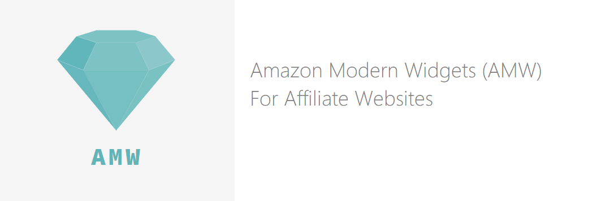
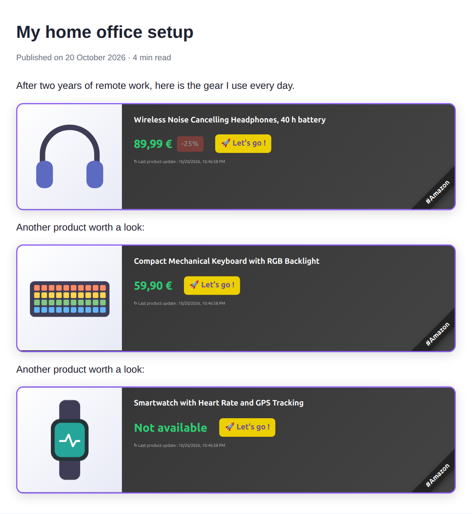

[](https://github.com/ltoinel/amw/actions/workflows/ci.yml?query=branch%3Adevelop)
[](https://github.com/ltoinel/amw/actions/workflows/github-code-scanning/codeql)
[](https://github.com/ltoinel/amw/actions/workflows/release.yml)
[](https://github.com/ltoinel/amw/actions/workflows/docs.yml)
[](https://ltoinel.github.io/amw/developer/testing/#coverage-thresholds)
[](https://github.com/ltoinel/amw/blob/develop/.github/dependabot.yml)

[](https://www.npmjs.com/package/amazon-modern-widgets)
[](https://www.npmjs.com/package/amazon-modern-widgets)
[](https://hub.docker.com/r/ltoinel/amw)
[](https://hub.docker.com/r/ltoinel/amw)
[](https://github.com/ltoinel/amw/releases)
[](https://github.com/ltoinel/amw/blob/develop/package.json)
[](https://www.conventionalcommits.org/)
[](LICENSE)

**Amazon Modern Widgets (AMW)** replaces the dated Amazon affiliate widgets with fast,
responsive product cards. A small Node.js server queries the Amazon Creators API with
your partner tag and caches the results in Redis. A single `widget.js` turns
`<div class="amw" id="ASIN">` placeholders into clickable cards on any website or CMS
(Ghost, WordPress, Drupal, static sites…), with lazy loading, seven languages and
SEO-friendly JSON-LD.

## 📖 Full documentation: https://ltoinel.github.io/amw/

## Quick start

Credentials are passed as environment variables: copy
[`.env.example`](.env.example) to `.env` and fill in your Creators API credentials
([all variables](https://ltoinel.github.io/amw/installation/configuration/#environment-variables)).

**Docker** (port `9080`, API under `/item`):

```bash
docker run -d --name amw -p 9080:9080 --env-file .env \
  ltoinel/amw:latest            # or ghcr.io/ltoinel/amw:latest
curl http://localhost:9080/item/health
```

**From a clone**, `./start.sh` runs everything (`./start.sh --help`):

```bash
./start.sh docker   # AMW + Redis in Docker, http://localhost:9080/item
./start.sh dev      # development container with hot reload
./start.sh          # local Node.js 26 run with config/production.yml
./start.sh stop     # stop the Docker stacks
```

**npm** (Node.js 26):

```bash
npm install amazon-modern-widgets
mkdir config && cp node_modules/amazon-modern-widgets/config/sample.yml config/production.yml
# edit config/production.yml (credentials, Server.projectDir, Server.path: /item)
node node_modules/amazon-modern-widgets/dist/main.js
```

Then proxy `/item/` from your website to AMW
([NGINX example](https://ltoinel.github.io/amw/installation/reverse-proxy/)).

## Add a widget to your page

```html
<html lang="en">
  <!-- ... -->
  <div class="amw" id="B084DN3XVN"></div>
  <script src="/item/widget.js" defer></script>
</html>
```



See [Add widgets to your website](https://ltoinel.github.io/amw/user-guide/integration/)
for the embedding options, JavaScript API and styling, and
[Product cards](https://ltoinel.github.io/amw/user-guide/widget/) for what readers see
(languages, savings badge, lazy loading).

## Contributing

Issues and pull requests are welcome. Every change follows *issue → branch → pull
request to `develop`* with [Conventional Commits](https://www.conventionalcommits.org/):
see [AGENTS.md](AGENTS.md) and the
[contributing guide](https://ltoinel.github.io/amw/developer/contributing/).

## License

[MIT](LICENSE) © Ludovic Toinel
