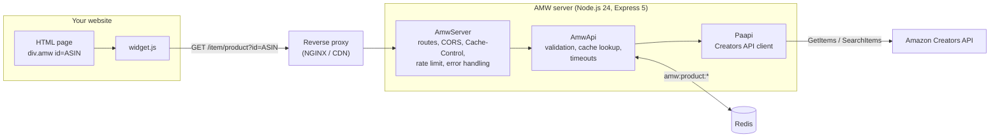
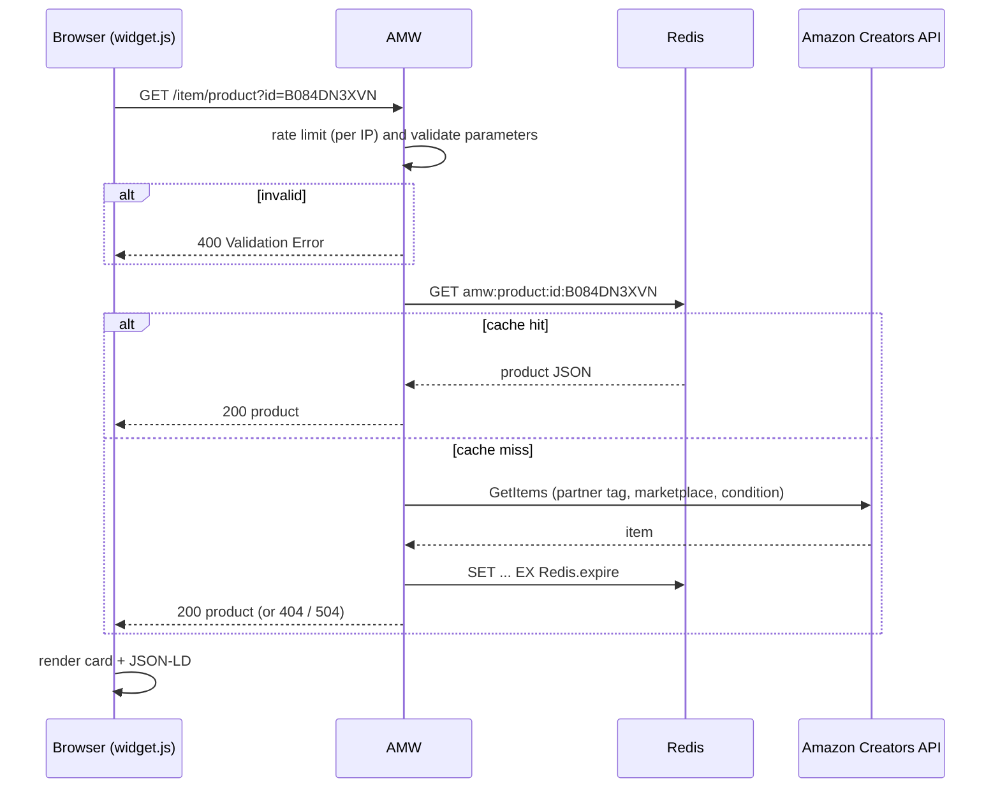

# Architecture

## Components



| Module | Role |
|---|---|
| `src/main.ts` | Entry point: defaults `NODE_ENV` to `production` and starts `AmwServer`. |
| `src/server/AmwServer.ts` | Express application: `trust proxy`, optional CORS, `Cache-Control`, routes (`/product`, `/widget.js`, `/health`, `/info`, optional `/openapi.json` and `/docs/`), per-IP rate limiter, 404/500 handlers, Redis connection, graceful shutdown. |
| `src/server/OpenApi.ts` | Builds the OpenAPI 3.1 document served when `Server.swagger` is enabled. |
| `src/server/AmwApi.ts` | `/product` and `/widget.js` handlers: parameter validation and sanitization, Redis lookup and storage, 30 s timeout, mapping of errors to HTTP status codes. |
| `src/server/Paapi.ts` | Wrapper around [`amazon-creators-api`](https://www.npmjs.com/package/amazon-creators-api): `getItemApi(id)`, `searchItemApi(keyword)` and `buildProduct()` which maps an Amazon item to the AMW product JSON. |
| `src/utils/ConfigLog4j.ts` | Log4j-style loggers (`typescript-logging`), debug level when `Server.debug` is true. |
| `src/widgets/widget.js` | Browser widget, minified to `dist/widgets/widget.js` by `scripts/build-widgets.js` (terser). |

## Request flow



## Repository layout

```text
amw/
├── src/                 TypeScript server and browser widget
├── tests/               Jest test suites
├── config/              sample, docker and development configurations,
│                        environment variable mapping (custom-environment-variables.yml)
├── docker/              production and development Dockerfiles and Compose files,
│                        Redis config, build/validate scripts
├── scripts/             widget build script, Docker smoke test
├── resources/           logo and screenshot
├── docs/                this documentation (MkDocs Material)
├── .devcontainer/       VS Code Dev Containers setup (uses the dev Compose file)
├── .github/workflows/   CI, release, dependency review and documentation workflows
├── .env.example         template of the environment variables (copy to .env)
├── start.sh             entry point: local, dev, docker and stop modes
├── AGENTS.md            contribution rules for humans and AI agents
├── SECURITY.md          security policy
└── mkdocs.yml           documentation site configuration
```
