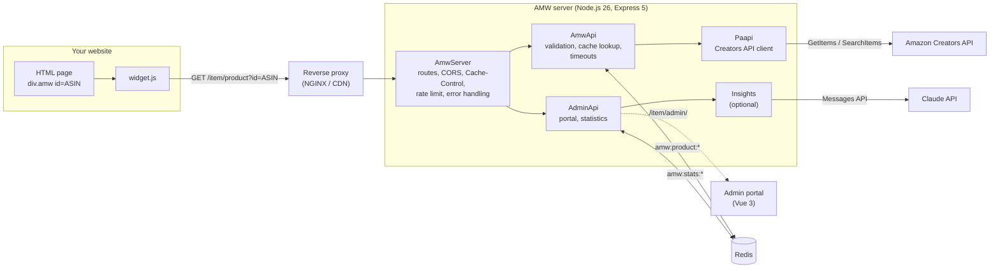
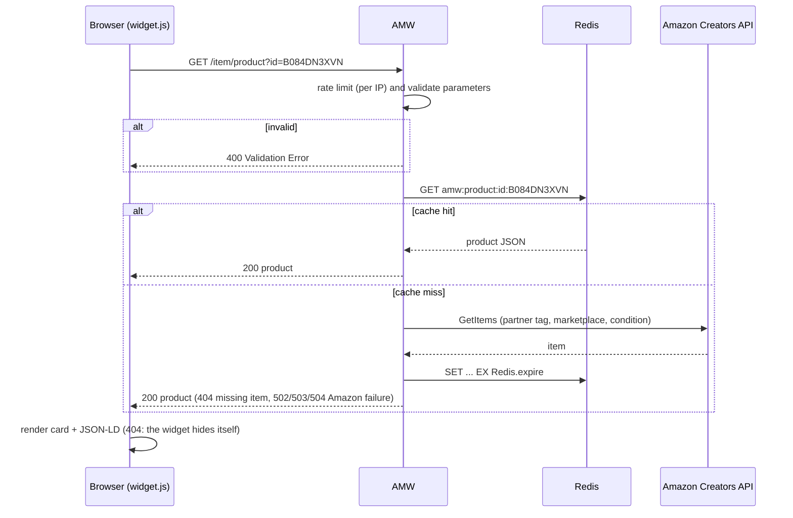

# Architecture

## Components

| Module | Role |
|---|---|
| `src/main.ts` | Entry point: defaults `NODE_ENV` to `production` and starts `AmwServer`. |
| `src/server/AmwServer.ts` | Express application: `trust proxy`, brotli/gzip compression, optional CORS, `Cache-Control`, routes (`/product`, `/products`, `/click`, `/widget.js`, `/widget.css` and their hashed copies, `/health`, `/info`, optional `/admin/`, `/metrics`, `/openapi.json` and `/docs/`), per-IP rate limiters, 404/500 handlers, Redis connection, graceful shutdown. |
| `src/server/OpenApi.ts` | Builds the OpenAPI 3.1 document served when `Server.swagger` is enabled. |
| `src/server/AmwApi.ts` | `/product`, `/products` and `/widget.js` handlers: Redis lookup and storage, 30 s timeout, mapping of errors to HTTP status codes. |
| `src/server/Schemas.ts` | zod schemas validating and normalizing the query parameters (ASIN format, keyword length and sanitization, `ids` list); their constants feed the OpenAPI document. |
| `src/server/AmazonError.ts` | Classifies Amazon SDK failures into `timeout` (504), `throttled` (503 + `Retry-After`) and `upstream` (502); a missing item is not an error (404). |
| `src/server/Paapi.ts` | Wrapper around [`amazon-creators-api`](https://www.npmjs.com/package/amazon-creators-api): `getItemApi(id)`, `getItemsApi(ids)`, `searchItemApi(keyword)` and `buildProduct()` which maps an Amazon item to the AMW product JSON. |
| `src/server/Resilience.ts` | Protects the Amazon quota: coalescing of identical concurrent requests, in-memory not-found cache, circuit breaker (`Amazon.breakerThreshold`). |
| `src/server/CacheControl.ts` | `Cache-Control` helpers: `no-store` by default, `public, max-age` per route. |
| `src/server/Settings.ts` | Reads and validates the configuration once; the settings are passed to every constructor. |
| `src/server/Stats.ts` | Usage statistics in Redis (`amw:stats:*`, daily counters kept 90 days) and the `/click` beacon handler. |
| `src/server/AdminApi.ts` | [Administration portal](../user-guide/admin-portal.md): password login with signed tokens, statistics API, static files of `dist/admin/`. |
| `src/server/Insights.ts` | Optional AI insights (`Admin.insights`): one Claude API call per analysis, validated JSON answer, cached one hour per period. |
| `src/utils/metrics.ts` | Prometheus metrics, served at `/metrics` when `Server.metrics` is enabled. |
| `src/utils/logger.ts` | pino loggers (JSON lines, pino-pretty in development; debug level when `Server.debug` is true) and the pino-http request logger that assigns the `X-Request-Id`. |
| `src/widgets/widget.js` | Browser widget, minified to `dist/widgets/widget.js` by `scripts/build-widgets.js` (terser); its stylesheet is `src/widgets/widget.css`. |
| `admin/` | Admin portal (Vue 3, Vite, Chart.js), built into `dist/admin/`. |

## Request flow

Cards that start loading together (the visible ones, or a fragment added to the page) are
requested with one `GET /item/products?ids=…` call, up to 10 ASINs each: the server answers
one result per ASIN through the same cache, and fetches the missing ones with a single
GetItems call. A lone card, or an id that is not an ASIN, keeps `GET /item/product`.

The files behind each component are described in [Code layout](code-layout.md).
