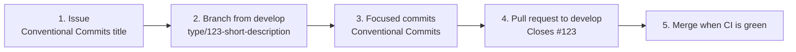

# Contributing

Contributions are welcome. The complete rules, shared by humans and AI coding agents,
are in [AGENTS.md](https://github.com/ltoinel/amw/blob/develop/AGENTS.md); here is the
short version.

## Workflow: issue → branch → pull request

Nothing is pushed directly to `develop` or `main`.



1. **Open an issue** describing the bug or feature, titled like a commit
   (`fix(widget): escape product id in error placeholder`).
2. **Create a branch from an up-to-date `develop`**, named
   `<type>/<issue-number>-<short-description>`:
   ```bash
   git switch develop && git pull
   git switch -c fix/42-escape-product-id
   ```
3. **Commit** with [Conventional Commits](https://www.conventionalcommits.org/).
4. **Open a pull request against `develop`** with a Conventional Commits title and
   `Closes #42` in the body.
5. The pull request is merged once CI (lint, build, tests, security audit, Docker
   build) is green. `main` only receives merges from `develop` for releases.

## Conventional Commits

```text
<type>(<optional scope>): <short imperative description>
```

- **Types**: `feat`, `fix`, `docs`, `style`, `refactor`, `perf`, `test`, `build`, `ci`,
  `chore`, `revert`, `security`.
- **Scopes** (suggested): `server`, `api`, `widget`, `cache`, `config`, `docker`, `ci`,
  `deps`.
- English, lowercase, imperative mood, no trailing period, 72 characters max.
- Breaking changes: `feat(api)!: ...` plus a `BREAKING CHANGE:` footer.

## Coding conventions

- Match the surrounding style (TypeScript strict mode, `this.log` logger).
- Read configuration only in `src/server/Settings.ts`: add the key to `Settings` (with its
  default and validation) and pass the settings to the class that needs them.
- Validate every request parameter and reject invalid input with `ValidationError`
  (HTTP 400).
- Use `req.ip` for client IPs, never raw `X-Forwarded-For`.
- In the widget, treat API data as untrusted: `textContent`, `safeUrl()`,
  `sanitizeText()`, never raw `innerHTML` with product data.
- Explain any new dependency in the issue; major upgrades get their own issue and PR.
- Keep the Docker image minimal: production dependencies only, non-root user, no
  package manager at runtime.
- Update this documentation in the same pull request when behaviour or configuration
  changes (see [Documentation site](documentation.md)).

## Comment guidelines

- Comments explain **why**: intent, constraints, security reasons, non-obvious
  behaviour. They never paraphrase the next line.
- Keep them accurate when the code changes, concise, and in English.
- JSDoc on public methods only when it adds information (contract, return values,
  thrown errors).

```ts
// Bad: restates the code
// Set trust proxy
this.app.set('trust proxy', AmwServer.TRUST_PROXY);

// Good: explains the constraint
// Must match the real proxy chain, otherwise clients can spoof X-Forwarded-For
// and bypass the per-IP rate limit
this.app.set('trust proxy', AmwServer.TRUST_PROXY);
```

## Pull request checklist

The [pull request template](https://github.com/ltoinel/amw/blob/develop/.github/pull_request_template.md)
asks for a summary, a test plan (`npm run lint`, `npm run build`, `npm test`) and the
`Closes #<issue>` line. Bug reports and feature requests use the
[issue forms](https://github.com/ltoinel/amw/issues/new/choose).

## Security issues

Do not open a public issue for a vulnerability: follow the
[security policy](https://github.com/ltoinel/amw/blob/develop/SECURITY.md) and use
[private vulnerability reporting](https://github.com/ltoinel/amw/security/advisories/new).
