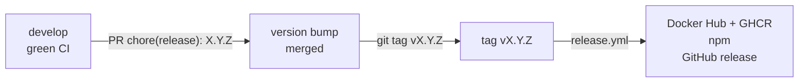

# Release process

Releases are cut by the maintainer from `develop`, the default branch: the version
bump goes through a pull request like any other change, then a tag starts the release
workflow.

## Steps

1. Make sure `develop` is green (CI, end-to-end tests, security audit).
2. Pick the version with [SemVer](https://semver.org/): a `BREAKING CHANGE` footer
   since the last tag makes a major, a `feat` a minor, a `fix` a patch
   (`git log --format=%B vX.Y.Z..develop | grep "BREAKING CHANGE"`). Squash merges keep
   the footer but may drop the `!` of the title, so check the footers.
3. Open a `chore(release): X.Y.Z` pull request that runs
   `npm version X.Y.Z --no-git-tag-version` (bumps `package.json` and
   `package-lock.json`) and adds the upgrade notes of a major to
   [Upgrade](../installation/upgrade.md). Merge it once CI is green.
4. Tag the merge commit and push the tag:
   `git switch develop && git pull && git tag vX.Y.Z && git push origin vX.Y.Z`.
5. The tag triggers
   [`release.yml`](https://github.com/ltoinel/amw/blob/develop/.github/workflows/release.yml),
   which:
    1. lints, builds and runs the tests;
    2. builds the multi-architecture image (`linux/amd64`, `linux/arm64`) and pushes it
       to `ghcr.io/ltoinel/amw` and Docker Hub `ltoinel/amw`, tagged `X.Y.Z`, `X.Y`, `X`
       and `latest`, with SLSA build provenance (`mode=max`) and SBOM attestations;
    3. publishes the npm package `amazon-modern-widgets` with
       [npm provenance](https://docs.npmjs.com/generating-provenance-statements), signed
       with the job's OIDC token (`id-token: write`);
    4. creates the GitHub release, with notes generated from the merged pull requests,
       and attaches the build artifacts.

The workflow can also be started manually with a version, which then gets the same
versioned image tags. The version (input or tag) must match `vX.Y.Z`
(`^v[0-9]+\.[0-9]+\.[0-9]+$`), otherwise the workflow stops before building anything.

!!! note "Version"
    The version reported by `/health`, `/info` and the OpenAPI document is read from
    `package.json` at startup: there is no other constant to update.

## Required secrets

| Secret | Used for |
|---|---|
| `NPM_TOKEN` | Publishing to npm (can be removed once npm [trusted publishing](https://docs.npmjs.com/trusted-publishers) is configured for `release.yml` on npmjs.com) |
| `DOCKERHUB_USERNAME`, `DOCKERHUB_TOKEN` | Pushing to Docker Hub |

GHCR uses the workflow's `GITHUB_TOKEN` (`packages: write` on that job only).
