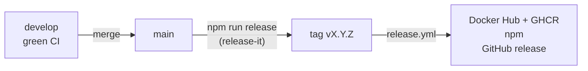

# Release process

Releases are cut by the maintainer from `main`, which only receives merges from
`develop`.

## Steps

1. Make sure `develop` is green (CI, end-to-end tests, security audit) and merge it into
   `main`.
2. On `main`, run `npm run release`. [release-it](https://github.com/release-it/release-it)
   asks for the new version (follow [SemVer](https://semver.org/): a `feat` is a minor,
   a `fix` a patch, a `BREAKING CHANGE` a major), bumps `package.json`, commits, tags
   `vX.Y.Z`, pushes and creates the GitHub release.
3. The tag triggers
   [`release.yml`](https://github.com/ltoinel/amw/blob/develop/.github/workflows/release.yml),
   which:
    1. lints, builds and runs the tests;
    2. builds the multi-architecture image (`linux/amd64`, `linux/arm64`) and pushes it
       to `ghcr.io/ltoinel/amw` and Docker Hub `ltoinel/amw`, tagged `X.Y.Z`, `X.Y`, `X`
       and `latest`, with SLSA build provenance (`mode=max`) and SBOM attestations;
    3. publishes the npm package `amazon-modern-widgets` with
       [npm provenance](https://docs.npmjs.com/generating-provenance-statements), signed
       with the job's OIDC token (`id-token: write`);
    4. attaches the build artifacts to the GitHub release.

The workflow can also be started manually with a version, which then gets the same
versioned image tags. The version (input or tag) must match `vX.Y.Z`
(`^v[0-9]+\.[0-9]+\.[0-9]+$`), otherwise the workflow stops before building anything.

!!! note "Version constant"
    The version reported by `/health`, `/info` and the OpenAPI document is the
    `RELEASE` constant in `src/server/AmwServer.ts`: update it together with
    `package.json`.

## Required secrets

| Secret | Used for |
|---|---|
| `NPM_TOKEN` | Publishing to npm (can be removed once npm [trusted publishing](https://docs.npmjs.com/trusted-publishers) is configured for `release.yml` on npmjs.com) |
| `DOCKERHUB_USERNAME`, `DOCKERHUB_TOKEN` | Pushing to Docker Hub |

GHCR uses the workflow's `GITHUB_TOKEN` (`packages: write` on that job only).
