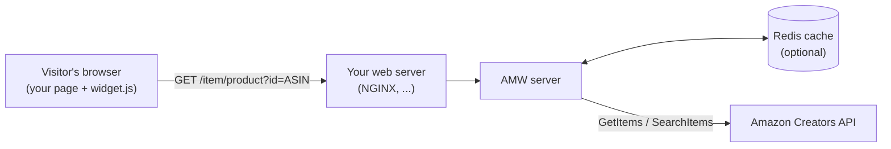

# Getting started

Running AMW takes three steps.

1. **Get Amazon Creators API credentials.** You need an Amazon Associates account with
   access to the [Creators API](https://affiliate-program.amazon.com/creatorsapi):
   a credential ID, a credential secret, the credential version, and your partner
   (tracking) tag.
2. **Run the AMW server**, either with [Docker](docker.md) (recommended) or with
   [npm / Node.js](npm.md), and give it your credentials through
   [environment variables or a configuration file](../configuration.md). From a clone
   of the repository, `./start.sh` does it in one command:

    ```bash
    cp .env.example .env     # fill in your Amazon credentials
    ./start.sh docker        # AMW + Redis in Docker on http://localhost:9080/item
    ```
3. **Expose it on your website** behind a [reverse proxy](reverse-proxy.md) and
   [add the widget](../widget.md) to your pages.



!!! tip "Same origin, `/item` path"
    The widget calls the API on **the same origin as the page**, under the **`/item`**
    path (`https://your-site/item/product?id=...`). The simplest setup is therefore to
    keep `Server.path: /item` (the Docker default) and proxy `/item` from your website
    to AMW. See [Widget integration](../widget.md#api-location) for other setups.

!!! note "Documentation version"
    This site documents the `develop` branch. Features added after the latest
    [release](https://github.com/ltoinel/amw/releases) (for example rate limiting and
    `Server.trustProxy`) are only available in images and packages published after them.
