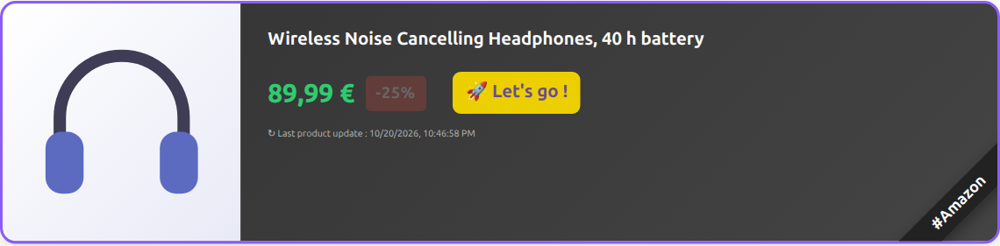

---
hide:
  - toc
---

<div class="amw-hero" markdown>

{ .amw-hero__logo }

# Amazon Modern Widgets

<p class="amw-hero__tagline">
Beautiful, fast and SEO-friendly Amazon product cards for your blog, powered by your
own server, your partner tag and the Amazon Creators API.
</p>

[:material-rocket-launch: Get started](installation/index.md){ .md-button .md-button--primary }
[:fontawesome-brands-github: GitHub](https://github.com/ltoinel/amw){ .md-button }
[:material-book-open-variant: User guide](user-guide/index.md){ .md-button }

<div class="amw-hero__screenshot" markdown>
{ width="620" }
</div>

</div>

## Why AMW?

<div class="grid cards" markdown>

-   :material-palette-swatch:{ .lg .middle } **Modern product cards**

    ---

    Image, title, price, savings badge and a localized call to action, styled
    independently of your theme. The whole card links to Amazon with your partner tag.

-   :material-lightning-bolt:{ .lg .middle } **Fast pages**

    ---

    One deferred script, lazy loading as cards scroll into view, and three cache layers
    in front of the Amazon API.

-   :material-google:{ .lg .middle } **SEO friendly**

    ---

    schema.org `Product` JSON-LD for every product and `sponsored nofollow` links.

-   :material-translate:{ .lg .middle } **Seven languages**

    ---

    French, English, Spanish, German, Italian, Portuguese and Dutch, picked from your
    page's `lang`.

-   :material-shield-lock:{ .lg .middle } **Secure by default**

    ---

    Untrusted data never rendered as HTML, strict validation, per-IP rate limiting,
    non-root Docker image.

-   :material-docker:{ .lg .middle } **Easy to run**

    ---

    Docker image for amd64 and arm64, Docker Compose with Redis, npm package, or
    `./start.sh` from source.

</div>

## Three guides

<div class="grid cards" markdown>

-   :material-book-open-variant:{ .lg .middle } **User guide**

    ---

    What AMW does, the product cards, caching, the HTTP API and Swagger UI, security,
    with screenshots.

    [:octicons-arrow-right-24: Read the user guide](user-guide/index.md)

-   :material-download:{ .lg .middle } **Installation**

    ---

    Step by step: credentials, Docker or npm, reverse proxy on your blog's domain,
    configuration, verification, upgrade and troubleshooting.

    [:octicons-arrow-right-24: Install AMW](installation/index.md)

-   :material-code-braces:{ .lg .middle } **Developer guide**

    ---

    Architecture, code layout, dev container, tests, CI/CD, releases and the
    contribution workflow.

    [:octicons-arrow-right-24: Contribute](developer/index.md)

</div>

## Quick start

```bash
cp .env.example .env      # add your Amazon Creators API credentials
./start.sh docker         # AMW + Redis on http://localhost:9080/item
```

```html
<div class="amw" id="B084DN3XVN"></div>
<script src="/item/widget.js" defer></script>
```

Works with any website or CMS that lets you insert HTML: Ghost, WordPress, Drupal,
Joomla, Dotclear, static site generators...

| | |
|---|---|
| Source code | [github.com/ltoinel/amw](https://github.com/ltoinel/amw) |
| npm package | [`amazon-modern-widgets`](https://www.npmjs.com/package/amazon-modern-widgets) |
| Docker images | [`ltoinel/amw`](https://hub.docker.com/r/ltoinel/amw) and `ghcr.io/ltoinel/amw` |
| Tutorial (French) | [Amazon affiliation with Modern Widgets](https://www.geeek.org/amazon-affiliation-modern-widgets/) |
| Contact | [ludovic@toinel.com](mailto:ludovic@toinel.com): share your blog posts and feedback |
| License | [MIT](https://github.com/ltoinel/amw/blob/develop/LICENSE) |
