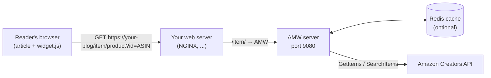

# Installation overview

This tutorial takes you from nothing to product cards on your blog. The steps:

1. check the [prerequisites](#prerequisites);
2. get your [Amazon Creators API credentials](#amazon-creators-api-credentials);
3. run AMW with [Docker](docker.md) (single container), [Docker Compose](docker-compose.md)
   (AMW + Redis, recommended), the [npm package](npm.md), or
   [from source](source.md) with `./start.sh`;
4. [expose it on your blog](reverse-proxy.md) under `/item`;
5. [verify](verify.md) the installation and [add widgets](../user-guide/integration.md)
   to your articles.



!!! tip "Same origin, `/item` path"
    The widget calls the API on **the same origin as the page**, under **`/item`**
    (`https://your-blog/item/product?id=...`). The simplest setup is therefore to keep
    `Server.path: /item` (the Docker default) and proxy `/item/` from your blog's domain
    to AMW. See [API location](../user-guide/integration.md#api-location) for other
    setups.

## Prerequisites

| You want to | You need |
|---|---|
| Run the Docker image | Docker |
| Run AMW with Redis | Docker with Compose v2 (`docker compose`) |
| Run with Node.js | Node.js **24** and npm |
| Build from source | git, plus Node.js 24 or Docker |
| Publish on your blog | A web server or CDN able to reverse-proxy a path (NGINX, Apache, Caddy, Traefik, ...) |

The Docker images are built for `linux/amd64` and `linux/arm64` (Raspberry Pi 4/5,
ARM cloud instances).

## Amazon Creators API credentials

AMW reads product data with the
[Amazon Creators API](https://affiliate-program.amazon.com/creatorsapi), which requires
an approved **Amazon Associates** account on the marketplace you target.

1. Sign in to Associates Central for your marketplace.
2. Open the [Creators API dashboard](https://affiliate-program.amazon.com/creatorsapi)
   and create credentials.
3. Write down the four values AMW needs:

| Value | Environment variable | Example |
|---|---|---|
| Credential ID | `AMAZON_CREDENTIAL_ID` | as shown in the dashboard |
| Credential secret | `AMAZON_CREDENTIAL_SECRET` | keep it secret |
| Credential version | `AMAZON_CREDENTIAL_VERSION` | `3.2` |
| Partner (tracking) tag | `AMAZON_PARTNER_TAG` | `myblog-21` |

Also set `AMAZON_MARKETPLACE` if you do not target `www.amazon.fr` (e.g.
`www.amazon.com`, `www.amazon.de`).

Put them in a `.env` file created from
[`.env.example`](https://github.com/ltoinel/amw/blob/develop/.env.example); it is read by
`docker run --env-file .env` and by both Docker Compose files (so by
`./start.sh docker` and `./start.sh dev`):

```ini title=".env"
AMAZON_CREDENTIAL_ID=<YOUR CREDENTIAL ID>
AMAZON_CREDENTIAL_SECRET=<YOUR CREDENTIAL SECRET>
AMAZON_CREDENTIAL_VERSION=3.2
AMAZON_PARTNER_TAG=<YOUR PARTNER TAG>
AMAZON_MARKETPLACE=www.amazon.fr
```

!!! danger "Keep credentials private"
    Never commit `.env` or paste credentials in an issue. Anyone holding them can use
    your Amazon quota.

!!! note "Documentation version"
    This site documents the `develop` branch. Features added after the latest
    [release](https://github.com/ltoinel/amw/releases) (environment variables,
    `./start.sh`, rate limiting, Swagger UI, ...) are only available in images and
    packages published after them.
