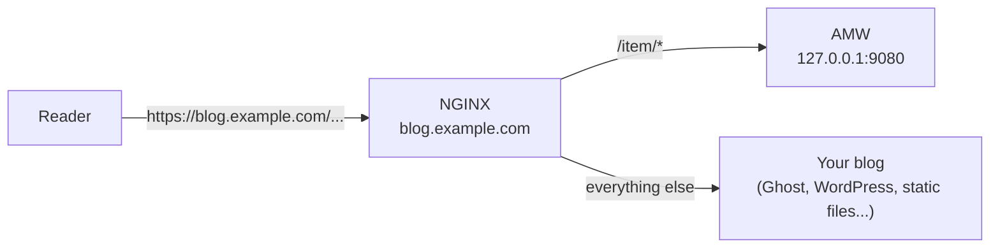

# Expose AMW on your blog

The widget fetches product data from **the same origin as the page**, under `/item`
(see [API location](../user-guide/integration.md#api-location)). So the last step is to
make `https://your-blog.example/item/` reach AMW, while every other path keeps serving
your blog.



## NGINX

### Step 1: add a `location` to your blog's server block

Example for a Ghost blog on `blog.example.com`, with AMW running on the same host
(Docker publishes it on `127.0.0.1:9080`):

```nginx title="/etc/nginx/sites-available/blog.example.com"
server {
    listen 443 ssl;
    server_name blog.example.com;

    ssl_certificate     /etc/letsencrypt/live/blog.example.com/fullchain.pem;
    ssl_certificate_key /etc/letsencrypt/live/blog.example.com/privkey.pem;

    # Amazon Modern Widgets: API and widget script under /item/
    location ^~ /item/ {
        proxy_set_header Host $http_host;
        proxy_set_header X-Real-IP $remote_addr;
        proxy_set_header X-Forwarded-For $proxy_add_x_forwarded_for;
        proxy_set_header X-Forwarded-Proto $scheme;
        proxy_pass http://127.0.0.1:9080;   # no URI part: /item/... is forwarded as is
        proxy_read_timeout 60s;             # AMW gives up on Amazon after 30 s
    }

    # The blog itself
    location / {
        proxy_set_header Host $http_host;
        proxy_set_header X-Forwarded-For $proxy_add_x_forwarded_for;
        proxy_set_header X-Forwarded-Proto $scheme;
        proxy_pass http://127.0.0.1:2368;   # Ghost; adapt to your blog
    }
}
```

`proxy_pass` has no URI part, so the request path is forwarded unchanged: AMW must be
configured with `Server.path: /item` (the Docker default).

### Step 2: reload and test

```bash
sudo nginx -t && sudo systemctl reload nginx
curl https://blog.example.com/item/health
```

!!! important "Set `Server.trustProxy`"
    Behind a proxy, every request reaches AMW from the proxy's address. Set
    [`Server.trustProxy`](configuration.md#server) to the number of proxies in front
    of AMW (`1` for a single NGINX, which is the Docker default) so that the client IP
    used by the rate limiter and the logs is read from `X-Forwarded-For`. Do not set it
    to `true` unless AMW is only reachable through trusted proxies: clients could then
    spoof their IP and bypass rate limiting. Add one hop per extra proxy (a CDN in front
    of NGINX, for example). The proxy must be the only way to reach AMW: publish its
    port on `127.0.0.1` (or firewall it), otherwise a client connecting directly sets
    `X-Forwarded-For` itself. `SERVER_TRUST_PROXY` sets the value from the environment.

## Micro-caching (optional)

AMW already sends `Cache-Control: public, max-age=<Server.httpCache>` on found products and `widget.js` (`no-store` elsewhere). You can additionally
cache responses in NGINX to absorb traffic spikes without reaching AMW at all:

```nginx
# in the http {} block
proxy_cache_path /var/cache/nginx/amw levels=1:2 keys_zone=amw_cache:10m
                 max_size=100m inactive=60m use_temp_path=off;

# in the server {} block
location ^~ /item/ {
    proxy_cache amw_cache;
    proxy_cache_valid 200 10m;
    proxy_cache_use_stale error timeout updating http_500 http_502 http_503 http_504;
    # ... proxy_set_header / proxy_pass directives from above
}
```

A CDN in front of your site achieves the same result. See
[Caching & quotas](../user-guide/caching.md).

## Other web servers

Any reverse proxy works as long as it forwards `/item/` unchanged and sets
`X-Forwarded-For`, for example:

=== "Caddy"

    ```text
    blog.example.com {
        handle /item/* {
            reverse_proxy 127.0.0.1:9080
        }
        handle {
            reverse_proxy 127.0.0.1:2368
        }
    }
    ```

=== "Apache"

    ```apache
    ProxyPreserveHost On
    ProxyPass        /item/ http://127.0.0.1:9080/item/
    ProxyPassReverse /item/ http://127.0.0.1:9080/item/
    ```

## Next step

[Verify the installation](verify.md), then [add widgets](../user-guide/integration.md) to
your articles.
