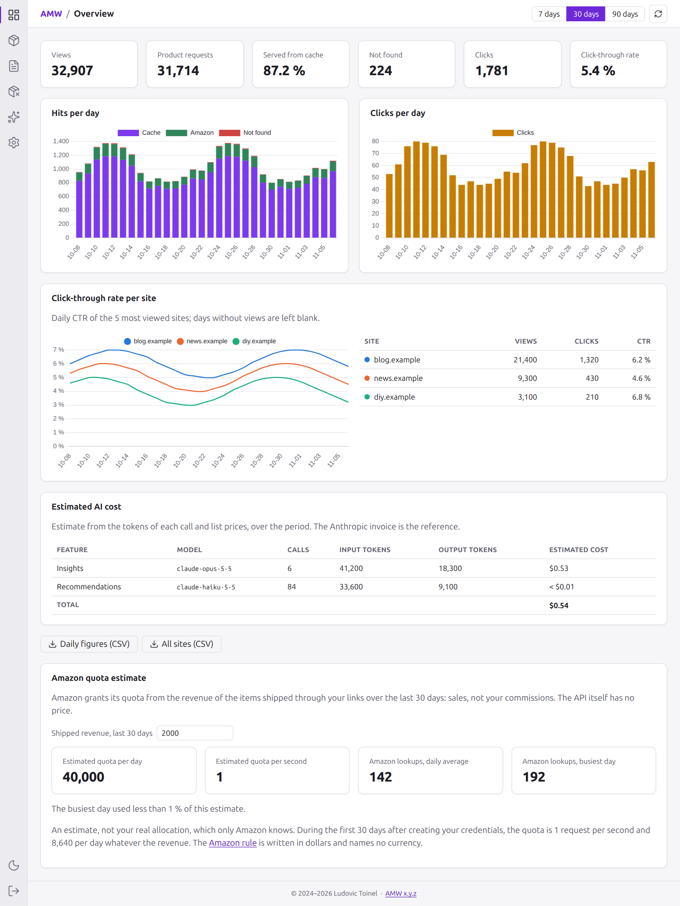
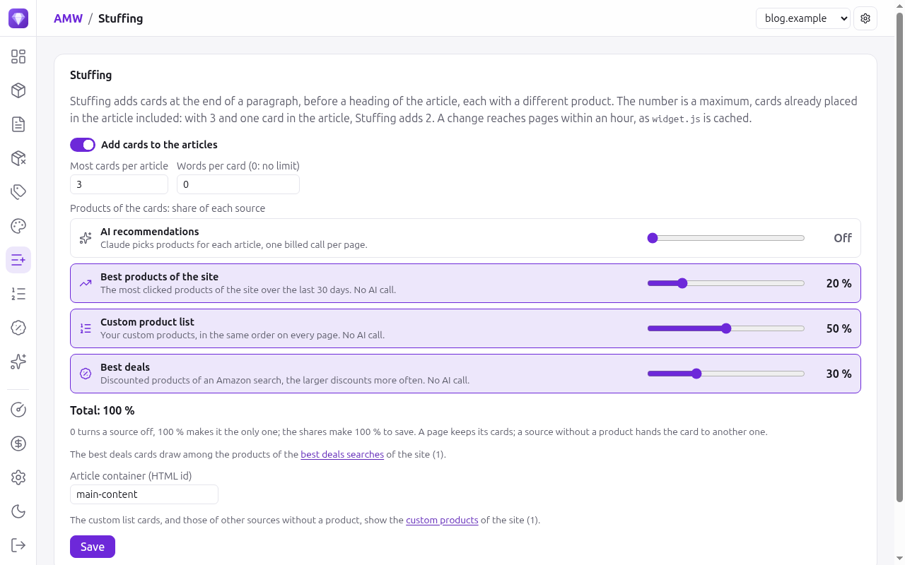
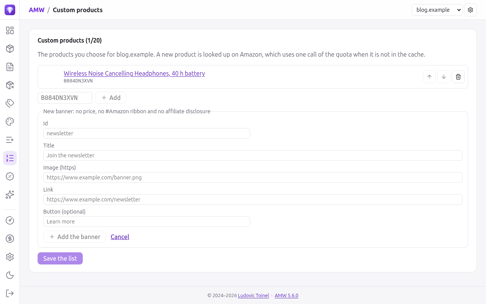
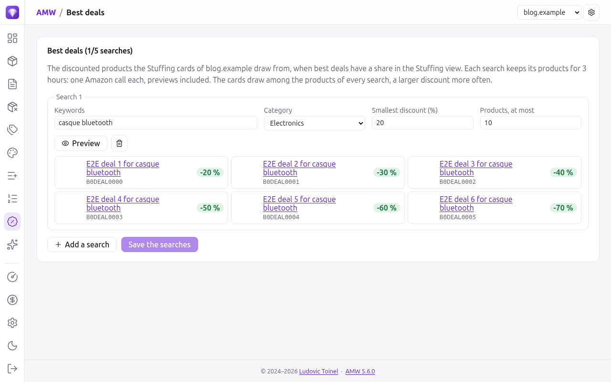
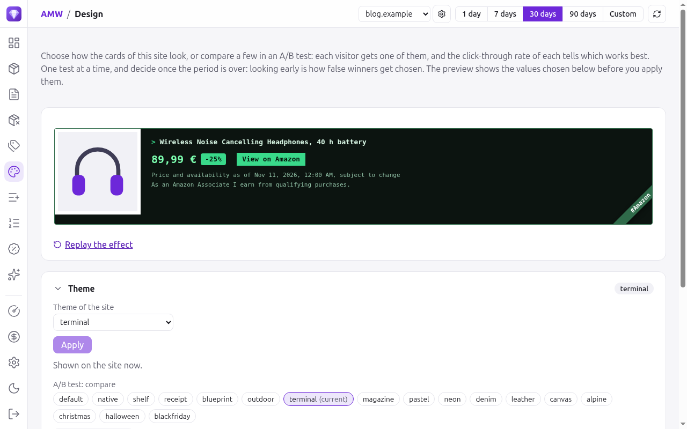

# Portal user manual

This manual walks through the [administration portal](admin-portal.md) task by task: what to look
at, what to change, and in which order. The [reference page](admin-portal.md) lists every view,
setting and API endpoint in detail.

The portal is at `<your server>/<Server.path>/admin/`, for example
`https://www.example.com/item/admin/`. It needs `Admin.enabled` and a password; see
[Enabling it](admin-portal.md#enabling-it).

## 1. Sign in and choose the site

1. Open the portal and type the password (`AMW_ADMIN_PASSWORD`). The session lasts
   `Admin.tokenTtl`; **Sign out** at the bottom of the menu ends it at once.
2. The portal opens on the **active site**, the one you used last, shown at the top right.
   Every view but the server ones (Amazon quota, AI cost, Server settings) shows and changes
   **this site only**. Pick another site in the list to switch.
3. The gear next to the list opens **Sites**: add each blog that embeds the widget, with a
   description, its address and, if it has one, its own Amazon tracking ID. A site that is not
   listed gets no card. Untick *AI recommendations* for a site whose pages must not ask Claude for
   products (and spend credits). See [Sites](admin-portal.md#sites).

!!! tip "Settings of each site"
    A new site follows the settings of every site. As soon as you save a setting while it is
    active (Stuffing, custom products, best deals, theme, effect, button label), the site gets
    its own, and the other sites keep theirs.

The menu groups the views in this order:

| Group | Views |
|---|---|
| Figures | Overview, Products, Pages, To replace, AI Recommendation |
| Cards | Design, Stuffing, Custom products, Best deals, AI |
| Server (bottom) | Amazon quota, AI cost, Server settings, then the light/dark switch and Sign out |

## 2. Read the figures {#figures}

Choose the **period** at the top right: *1 day*, *7 days*, *30 days*, *90 days* or *Custom* (two
dates within the last 90 days). Every figure and table of the figure views follows it, and the
refresh button reloads them.

- **Overview**: the key figures of the site, each with its trend and its change against the
  period just before. **Visits** counts the pages where a card was seen, once per browser tab
  session; **Impressions** counts the cards seen; **Clicks** and the **Click-through rate** tell how
  many went to Amazon. Below, the hits and clicks per day, and the daily click-through rate.
- **Products** and **Pages**: the products shown and the pages that show them, ranked by impressions,
  clicks or click-through rate. The rate is green when well above the site's, red when well
  below. Export any table as CSV.
- **To replace**: the products Amazon no longer returns and that pages still ask for during the
  period, with how long they have been missing and the pages to fix. Replace them in your
  articles, or in the custom list.
- **AI Recommendation**: the pages whose card is chosen by Claude, with the Amazon search it
  picked. Edit the keywords of a page by hand, or empty them so that the page shows the most
  clicked product of the site. *Without keywords* keeps the pages left without any.

!!! note "Privacy"
    Impressions, clicks and visits are counted with no cookie and no identifier: the widget only
    remembers, for the tab session, what it already counted.

## 3. Choose where the cards come from

**Stuffing** adds cards to the articles by itself, at the end of paragraphs. Turn it on with the
switch, then set:

- **Most cards per article**, and optionally **words per card**, so that a short article gets
  fewer cards;
- **the share of each source** with the sliders:

| Source | What the cards show | Cost |
|---|---|---|
| AI recommendations | Products Claude picks for each article | One billed Claude call per page |
| Best products of the site | The most clicked products of the site over 30 days | None |
| Custom product list | Your own list, in order | None |
| Best deals | Flash sales and largest discounts of your Amazon searches | Up to 3 Amazon calls per search every 3 hours |

Each slider goes from **0** (the source is off) to **100 %** (the only source). The shares must
make **100 %** to be saved: the total turns red above 100 %. Each card draws its source by these
shares, a page keeps its cards between visits, and a source with nothing to show hands the card
to another one.

### Custom products

The **Custom products** view holds your list for the site: type an ASIN (the ten characters after
`/dp/` in an Amazon address) and **Add**, order with the arrows, remove with the bin, then
**Save the list**. Each product is shown with its image and title, so a wrong ASIN is easy to spot.

**Banners of your own** can join the list: an id, a title, an https image, a link and an
optional button text. Their cards show no price, no *#Amazon* ribbon and no affiliate
disclosure, and cost no Amazon call: use them for a newsletter, a guide or your own shop.

### Best deals

The **Best deals** view holds up to five Amazon searches: keywords, a category, the smallest
discount and the most products for each. **Preview** shows what Amazon returns, with the
discount of each product and a *Flash sale* tag on the flash sales, in the order of the cards:
the flash sales still running first, then the largest discounts.

!!! warning "Amazon quota"
    Each search costs one Amazon call every 3 hours, previews included. Five searches on five
    sites is up to 25 calls every 3 hours: keep an eye on **Amazon quota**.

## 4. Design the cards and test them

The **Design** view sets how the cards of the site look. The **preview** at the top shows a card
with the theme, effect and button label chosen below, before you apply them; *Replay the effect*
plays the appearance effect again.

Unfold one block at a time:

- **Theme**: the look of the card, from *default* to the seasonal *christmas*, *halloween* and
  *blackfriday*;
- **Appearance effect**: a short movement when the card comes into view;
- **Button label**: *See the offer on Amazon*, *Check the price on Amazon*, *View on Amazon* or
  *Buy on Amazon*.

To change the site at once, pick a value and **Apply**.

To find out which works best, run an **A/B test**:

1. In one block, tick two values or more (the current one is ticked already) and
   **Start the test**. Each visitor then gets one of them for the tab session.
2. While the test runs, the timer next to **Stop the test** says for how long, and the other
   blocks are **locked**: changing the theme during a label test would spoil its results.
3. Read the results below the block once the period you chose is over, not as soon as a line
   looks good. *Better* or *Worse* need 500 impressions and 10 clicks on both sides.
4. **Keep** the best line to end the test with it, or **Stop the test** to go back to the value
   of the site.

## 5. AI

- **AI** (insights): Claude reads the figures of the site over the period and suggests what to
  change. **Regenerate** asks for a new analysis, which is billed.
- **AI Recommendation**: see [Read the figures](#figures).
- **AI cost** (bottom of the menu): the estimated cost of the Claude calls over the period, per
  feature and model, for every site together.

The AI features can be paused in **Server settings** without a restart.

## 6. Server views

- **Amazon quota**: the share of the daily Amazon quota used, and an estimate of what the
  current traffic will use. The quota belongs to your Associates account, so it covers every
  site.
- **Server settings**: the configuration in use (secrets are never shown), the
  [live settings](admin-portal.md#live-settings) you can change without a restart (default theme,
  caching, rate limits, AI pauses), a button to test the Amazon credentials, and the
  [backup](admin-portal.md#backup) of the portal settings to download or restore.

## Everyday recipes

| I want to… | Do this |
|---|---|
| Add a new blog | Gear next to the site list → add the site, then set its Stuffing |
| Show only my own products | Stuffing → *Custom product list* at 100 %, then fill **Custom products** |
| Promote my newsletter between Amazon cards | Custom products → *Add a banner*, then give the custom list a share in Stuffing |
| Show discounts in a category | Best deals → add a search and preview it, then give *Best deals* a share |
| Stop spending on Claude | Stuffing → *AI recommendations* at 0, or pause the AI in Server settings |
| Fix pages with broken products | To replace → open the listed pages and change their ASINs |
| Pick the best button label | Design → Button label → tick the labels → Start the test; Keep the winner a few weeks later |
| Dress the cards for Christmas | Design → Theme → *christmas* → Apply; Apply your usual theme in January |

The changes reach the pages within an hour, as browsers and CDNs keep `widget.js` that long.
