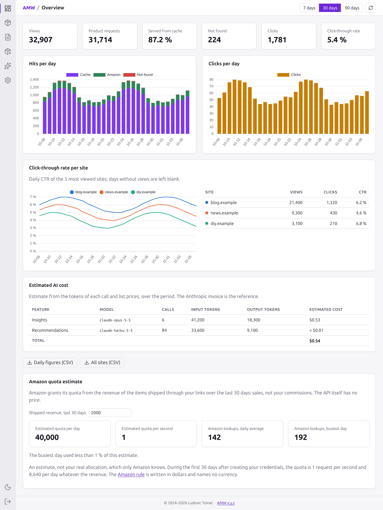
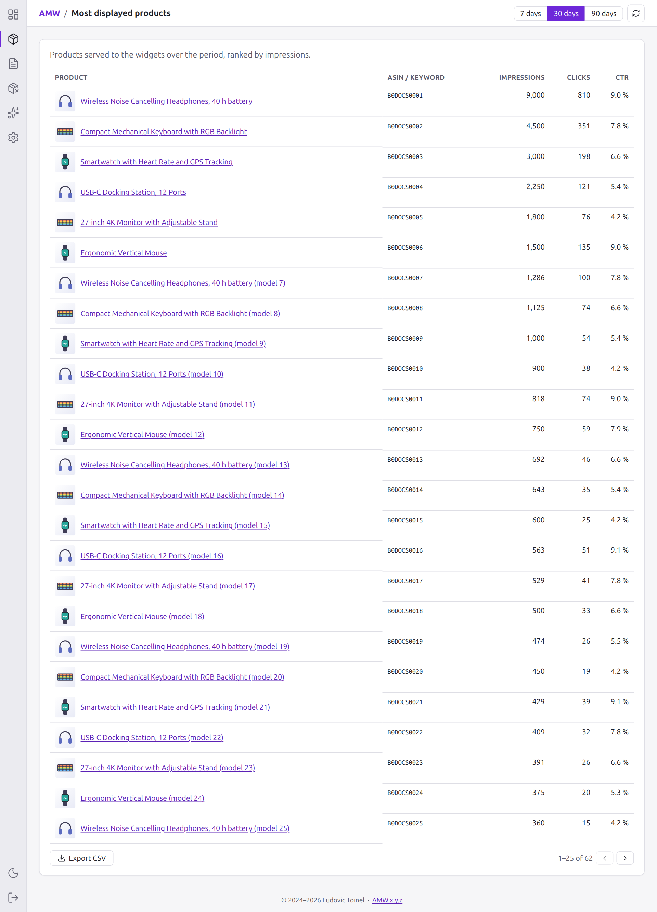
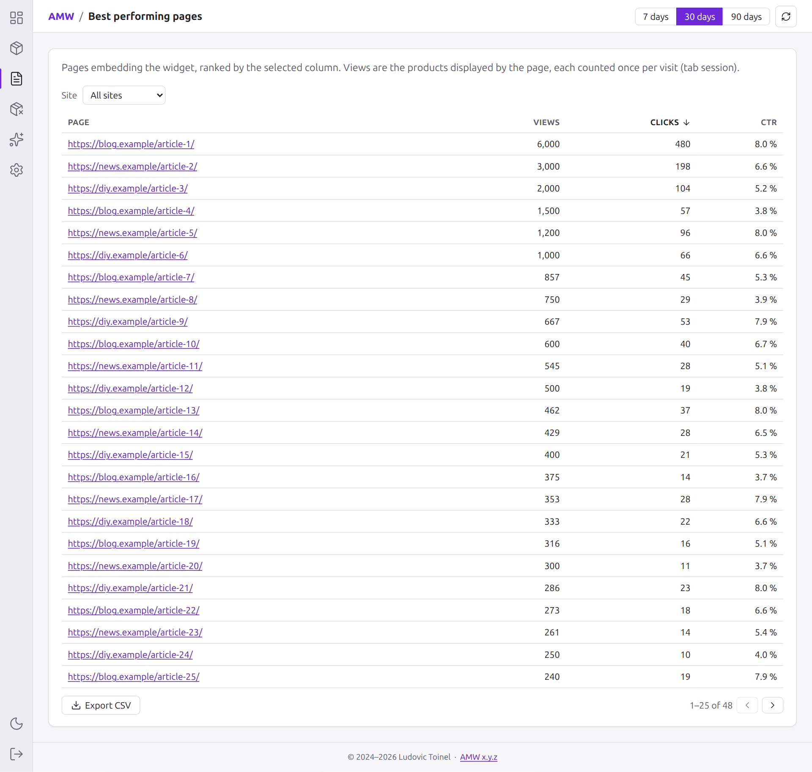
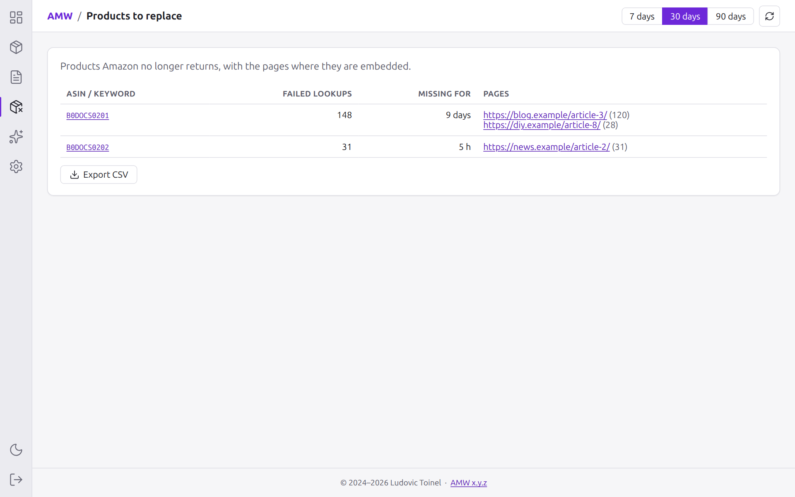
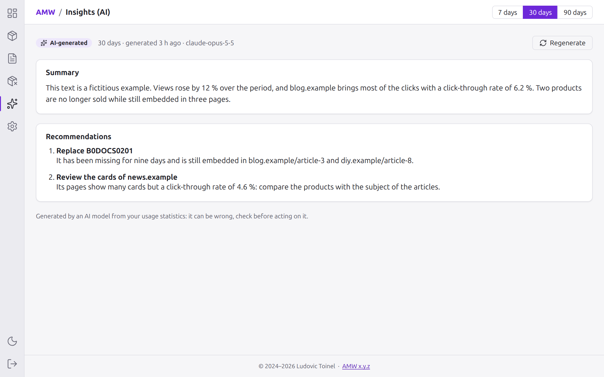
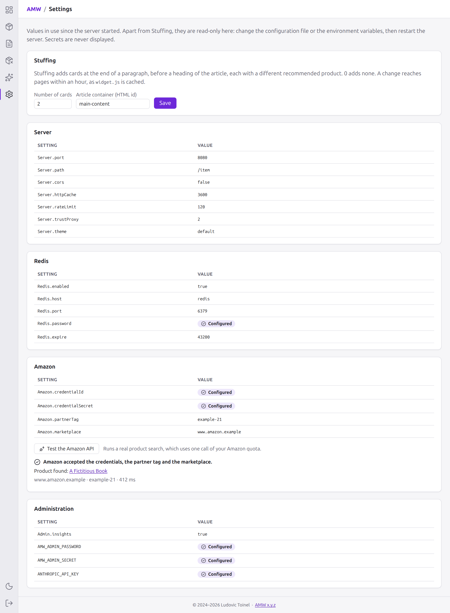

# Administration portal

AMW ships a small web portal, served at `<Server.path>/admin/` (`/amw/admin/` by
default), that shows how the widgets are used: hits, clicks, the most displayed
products, the best performing pages, the products to replace, AI-generated
insights and the settings in use.

## Enabling it

| Setting | Environment variable | Default | Description |
|---|---|---|---|
| `Admin.enabled` | `AMW_ADMIN_ENABLED` | `false` | Serves the portal and its API. |
| — | `AMW_ADMIN_PASSWORD` | — | Required, at least 12 characters: the server refuses to start without it. |
| — | `AMW_ADMIN_SECRET` | random | Token signing key. When unset, admins are logged out on every restart. |
| `Admin.tokenTtl` | `AMW_ADMIN_TOKEN_TTL` | `864000` | Session lifetime, in seconds (10 days by default). |
| `Admin.loginRateLimit` | `AMW_ADMIN_LOGIN_RATE_LIMIT` | `10` | Failed logins allowed per IP every 15 minutes. |
| `Admin.allowedIps` | `AMW_ADMIN_ALLOWED_IPS` | `[]` | Addresses or CIDR ranges allowed to reach the portal; empty allows every address. See [below](#allowed-ips). |
| `Admin.settingsFile` | `AMW_ADMIN_SETTINGS_FILE` | `""` | JSON file holding the settings changed in the portal; empty keeps them in Redis. See [below](#settings-file). |
| `Admin.insights` | `AMW_ADMIN_INSIGHTS` | `false` | AI insights written by Claude (see [Privacy](#privacy)). Also needs `ANTHROPIC_API_KEY`. |
| — | `ANTHROPIC_API_KEY` | — | Claude API key, environment only, used by the insights. |

### Sessions

After logging in, the portal keeps its token in the browser's `localStorage`: the session
survives closing the tab or the browser until `Admin.tokenTtl` (10 days by default)
has elapsed or the admin clicks **Sign out** (bottom of the activity bar). Shorten it on a shared computer.

- Set `AMW_ADMIN_SECRET` (a long random string, e.g. `openssl rand -base64 32`), otherwise
  every restart or update of the server logs admins out.
- Tokens are not stored on the server, so one cannot be revoked before it expires: to end
  every session at once, change `AMW_ADMIN_SECRET` and restart.

Statistics are stored in Redis (`Redis.enabled: true`): without Redis the portal only
shows the settings and says that statistics are unavailable. Daily counters are kept 90 days.

### Restricting the portal to your addresses { #allowed-ips }

`Admin.allowedIps` lists the IP addresses, or CIDR ranges, that may reach the portal and its API,
login included. Other addresses get a 403 before the login form is even checked.

```yaml
Admin:
  allowedIps: ["203.0.113.7", "10.0.0.0/8", "2001:db8::/32"]
```

or `AMW_ADMIN_ALLOWED_IPS='["203.0.113.7","10.0.0.0/8"]'`. An invalid entry stops the server at
startup. The list is read from the configuration only, never from the portal: a mistake there
would lock you out, and a stolen session could lift it.

- The address checked is the one AMW derives from
  [`Server.trustProxy`](../installation/configuration.md#server). Behind a reverse proxy (or
  Cloudflare) that is not trusted, every request carries the proxy's address: either nobody gets
  in, or everybody does if that address is listed. Count every hop, Cloudflare included.
- With `Server.trustProxy: true`, any client can forge its address in `X-Forwarded-For`, and the
  filter is useless; the server logs a warning at startup.
- A dynamic home address changes: prefer a VPN or a fixed range, and keep a way to edit the
  configuration on the server if you get locked out.

### Where the portal keeps its settings { #settings-file }

The sites, stuffing, effects, theme test and live settings changed in the portal override the
configuration files. By default they live in Redis, next to the cache: a Redis without
persistence, or a `FLUSHALL` meant to empty the cache, brings them back to the configuration
values. `Admin.settingsFile` keeps them in a JSON file instead:

```yaml
Admin:
  settingsFile: /app/data/settings.json
```

- The server checks at startup that the directory exists and is writable. The file is created by
  the first save, written in full each time through a temporary file, and re-read every minute,
  so several processes sharing it end up with the same values.
- A setting the file does not hold yet is still read from Redis: switching loses nothing, and
  the next save of that setting moves it to the file.
- The Docker image is read-only except `/app/data`: mount a volume there
  (`-v amw-data:/app/data`). A bind mount must be writable by the user `1001`.
- The file can be backed up, or edited by hand while the server runs: an invalid file is ignored
  with a warning, and the portal refuses to save rather than overwrite it.

## Dashboard

The portal is laid out like a code editor: an **activity bar** on the left (at the
bottom of the screen on phones) switches between views, and a **title bar** shows the
current view, the period selector (7, 30 or 90 days) and a refresh button. The period
applies to every view except the products to replace and the keywords, which are running lists,
and the settings.

| View | Address | Content |
|---|---|---|
| **Overview** | `#/overview` | Key figures (views, distinct products shown over the period, product requests, share served from the Redis cache, products not found, clicks, overall click-through rate), the hits per day / clicks per day charts, and the click-through rate per site: daily CTR of the 5 most viewed sites (blank on days without views) with a table of every site. Once Claude has been called, also the [estimated AI cost](#ai-cost). |
| **Products** | `#/products` | Most displayed products: impressions, clicks and click-through rate per product, and how long its copy has been in the cache (fetched from Amazon at most 24 hours ago, the exact time on hover; `—` when it is not cached). |
| **Pages** | `#/pages` | Best performing pages: the pages embedding the widget (top 20) with their views, clicks and click-through rate. Click a column header to rank them by views, clicks or CTR, and use the **Site** filter to show the pages of a single domain. |
| **To replace** | `#/notfound` | Products Amazon no longer returns, with their title when it is known, how long they have been missing (hours, then days after 48 h), a link to their Amazon page (product page for an ASIN, search for a keyword) and the pages where they are still embedded. |
| **Keywords** | `#/keywords` | Pages with a [widget without an `id`](widget.md#auto) and the Amazon search chosen for them, with a search field. Edit the keywords by hand, or empty them so that the page has no chosen product; see [Keywords](#keywords). |
| **To replace** | `#/notfound` | Products the Amazon API does not return, so their cards stay hidden, with how long they have been missing (hours, then days after 48 h), a link to their Amazon page (product page for an ASIN, search for a keyword) and the pages where they are still embedded. |
| **Insights** | `#/insights` | AI-generated summary and recommendations, see [Insights (AI)](#insights). |
| **A/B tests** | `#/abtests` | Themes and appearance effects compared, chosen here, with the click-through rate of each over the period; see [A/B tests](#effects). |
| **Sites** | `#/sites` | Your sites, with a description, a URL and a tracking ID each: the only ones that may show the widget and get recommendations. See [Sites](#sites). |
| **Settings** | `#/settings` | Settings in use since the server started, available without Redis. Each one shows its name in the configuration files, its environment variable (marked *environment only* for the secrets that have no configuration key, such as `Admin.password`) and what it does. Otherwise read-only: change the configuration file or the environment variables, then restart. Secrets are never displayed, only whether they are configured. The [**Test the Amazon API**](#amazon-test) button checks the Amazon settings. It is also where you change the [live settings](#live-settings) and the [cards added by Stuffing](integration.md#stuffing), stored in Redis or in `Admin.settingsFile`. |

**Tables** show 25, 50, 100 or 200 rows per page (chosen below the table and remembered by the
browser), up to the 500 first rows. The search field above the products, pages and products to
replace filters the loaded rows: title, ASIN or keywords, and page URLs. Their **Export CSV**
button downloads every loaded row matching the search, not only the page on screen; the overview also exports the daily
figures and all the sites. Files are comma-separated UTF-8 with CTR as a ratio (`0.05` for
5 %). Cells starting with `=`, `+`, `-` or `@` get a leading `'`, because titles and URLs come
from third parties and must not run as formulas in a spreadsheet.

The selected view is kept in the address (`/amw/admin/#/pages`), so reloading the page,
bookmarking a view and the browser back button all work.

- **Keyboard**: <kbd>Tab</kbd> reaches the activity bar, the arrow keys (and
  <kbd>Home</kbd> / <kbd>End</kbd>) move between views, <kbd>Enter</kbd> or
  <kbd>Space</kbd> opens the focused one.
- **Theme**: light or dark, following the system preference by default. The sun / moon
  button at the bottom of the activity bar switches it; the choice is remembered in the
  browser. The sign out button sits below it.

### Screenshots

All the data below is fictitious.

=== "Overview"

    { loading=lazy }

    Key figures, charts, click-through rate per site, estimated AI cost and Amazon quota.

=== "Products"

    { loading=lazy }

    Most displayed products.

=== "Pages"

    { loading=lazy }

    Best performing pages, with sorting, the site filter, pagination and the CSV export.

=== "To replace"

    { loading=lazy }

    Products the Amazon API does not return.

=== "Insights"

    { loading=lazy }

    AI-generated summary and recommendations.

=== "Settings"

    { loading=lazy }

    Settings in use, secrets hidden, and the Amazon test.

### Views, clicks and pages

- A **view** (impression) is one product displayed by a page during a visit, reported with
  the `/view` beacon whatever cache the product came from (browser, CDN, the widget's own
  5-minute cache). Within one browser tab session, a product counts once per page: reloading
  the page or showing the product twice adds nothing. A page showing three products counts
  three views per visit, and lazy loaded cards only count once they load. Products not
  found are not views. Direct API calls to `/product`, and visitors whose browser blocks
  the beacon, are not counted.
- Views measure **tab sessions, not people**: the widget only remembers them in the
  browser's `sessionStorage`, with no cookie and no identifier, so a new tab or another
  browser counts again. Where `sessionStorage` is blocked, a reload also counts again.
- **Product requests** are the lookups that reached AMW (`Cache`, `Amazon` and `Not
  found` in the chart). They fall when a CDN serves the products: this measures the load
  on the server and the Amazon quota, not the audience.
- A **click** is one `/click` beacon, sent by the widget when its affiliate link is
  followed.
- A **product** is an ASIN. Keywords only appear for the days recorded before views
  were reported by the widget.
- A **product to replace** is one the Amazon API reported as missing, so its card stays hidden. It
  is not always gone from the site: Amazon answers the same way for a product its API cannot
  serve, and a request with `Amazon.condition: New` may leave out one sold used. A product without
  an offer or an image is not concerned: its card is shown without a price or an image. It leaves the list as soon
  as Amazon returns it again (back in the catalogue), with the pages recorded for it.
- **Days are UTC**: the counters roll over at midnight UTC, so evening traffic in
  Europe or America may be counted on the next day.
- The **page** is the `Referer` header of the product request or of the click beacon,
  reduced to its origin and path: the query string and the fragment are dropped, as
  they may carry personal or session data. Requests without a usable `Referer` count in
  the global figures but in no page.

!!! note "Browsers often send only the site, not the page"
    Under the default `strict-origin-when-cross-origin` referrer policy, browsers only
    send the origin (`https://blog.example/`) on cross-origin requests, so pages of a
    same site are grouped together when AMW runs on another domain. The recommended
    setup, AMW proxied under the same origin as your site (see
    [Reverse proxy](../installation/reverse-proxy.md)), gets the full page path;
    otherwise set a less strict `Referrer-Policy` on your site, such as
    `no-referrer-when-downgrade`.

The `Referer` is sent by the client and can be forged: every set is bounded (1,000
pages and 1,000 products per day, 500 products to replace, 20 pages per missing
product) and the portal only renders `http(s)` URLs as links, opened with
`rel="noopener noreferrer"`.

!!! warning "Statistics share Redis with the product cache"
    They are stored in the same Redis as the cached products. The repository's Redis
    configuration evicts any key when it reaches `maxmemory` (`allkeys-lru`, 256 MB),
    so under memory pressure old statistics can disappear along with cached products.
    Give Redis enough memory for both, or point AMW to a Redis whose eviction policy
    fits your retention needs.

## Insights (AI) {#insights}

The **Insights** view is the only place where the portal uses AI: it sends the
statistics of the selected period to Claude (Claude Opus 5.5, through the Anthropic API)
and shows what Claude makes of them:

- a **summary** of the period in 3 to 6 sentences;
- at most 6 **recommendations**, each naming the pages or products concerned, for
  example a page that gets many views but few clicks, a product Amazon no longer knows
  to replace on a given page, or a traffic trend.

Claude only sees the figures the portal already shows (see [AI insights](#ai-insights)
for the exact list): no IP address, user agent or cookie, which AMW never stores anyway.

!!! note "Enabling it"
    The feature is disabled by default. Set `Admin.insights: true` (or
    `AMW_ADMIN_INSIGHTS=true`) and put your Claude API key in `ANTHROPIC_API_KEY`
    (for Docker, in `.env`), then restart AMW. Each analysis is billed to your
    Anthropic account, a few thousand tokens per call.

- Opening the view never calls Claude: it shows the last analysis of the selected
  period, whatever its age, with when it was generated and by which model. A period
  never analysed shows a **Generate** button.
- **Generate** / **Regenerate** asks Claude for a new analysis of the period. It takes
  10 to 60 seconds: a progress indicator shows meanwhile. Clicks within a minute of the
  previous analysis return it instead of making a new call.
- The last analysis of each period is stored in Redis (kept 90 days, like the
  statistics), so it survives a restart.
- When the feature is disabled the view says why and how to enable it.
- The content is labelled **AI-generated**: it can be wrong, check it before acting on
  it. It is derived from client-controlled data (page URLs), so the portal renders it
  as plain text only, never as HTML or Markdown.

## Keywords { #keywords }

The **Keywords** view lists the pages whose keywords were chosen by Claude, most recent first:
the page, its title, the keywords, and a link to see what Amazon returns for them. It needs
[`Recommendation.enabled`](../installation/configuration.md#recommendation). Like the other
tables, it can be searched, paged and exported as CSV.

A manual edit is kept like any recommendation, without expiry, and the first suggestion from
Claude stays shown next to it. It is not billed and Claude is not called again for this page.
AMW uses it for the next request it receives, but **a product already cached stays until it
expires**: up to 24 hours in a CDN or a browser. To apply it sooner, purge the URL shown after
saving, `<path>/product?page=<md5>`, in your CDN; browsers keep their copy until it expires.

## Estimating the Amazon quota {#amazon-quota}

The overview estimates your [Amazon quota](caching.md#amazon-api-quotas): type the shipped
revenue of the last 30 days, taken from your Associates reports, and compare the result with the
Amazon lookups of the period.

- The amount stays in your browser (`localStorage`) and is never sent to the server.
- It is an **estimate**: only Amazon knows your real allocation, its rule names no currency, and
  the portal assumes at least one request per second, which the rule does not state.
- The lookups are approximate: products remembered as not found count without a call, while AI
  recommendations and the Amazon test call Amazon without counting.
## Estimated AI cost {#ai-cost}

The overview shows what the Claude API calls of the period (AI insights and product
recommendations) should cost: calls and tokens per feature and model, and an amount in US
dollars computed from a table of list prices kept in the code.

- It is an **estimate**: the Anthropic invoice is the reference, and the prices of the table
  can become outdated with a release of AMW. A model missing from the table shows its tokens
  and no price, and the total then says so.
- Calls are counted from the upgrade on, including those whose answer is refused or unusable,
  which are billed too. Counters are kept 90 days like the other statistics, and require Redis.
## Testing the Amazon API {#amazon-test}

The **Test the Amazon API** button of the Settings view runs a real product search with the
settings of the server, then says whether Amazon accepted the credentials, the partner tag
and the marketplace, or what to check.

- Each test uses **one call of your Amazon quota**, and only runs when you click. A click
  less than 10 seconds after a test shows its result again without calling Amazon.
- It also checks that the links Amazon returns carry your partner tag.
- It bypasses the circuit breaker, so it also works while AMW has stopped calling Amazon.
- Changing a setting needs a restart of the server before the test can see it.

## Sites {#sites}

The **Sites** view lists your sites: add one with **Add a site**, remove it with the bin, then
**Save**. Each site has:

- a **host**, lowercase with the port if not the default (`www.example.com`, `localhost:8082`);
  list `example.com` and `www.example.com` if you use both;
- a **description** and a **URL**, shown in the portal only;
- a **tracking ID**, see [below](#partner-tags).

Only these sites may show the widget and, when recommendations are on, spend Claude credits. An
empty list allows every site, without recommendations. The list starts as `Server.allowedSites`
(with the tracking IDs set per site before 5.5); once saved, it replaces that setting, which then
only applies again if the portal setting is removed from Redis or `Admin.settingsFile`. The API and
CORS apply a change within a minute, pages when `widget.js` leaves the caches, up to an hour later.

### Tracking ID per site {#partner-tags}

Each site can have its own Amazon tracking ID (such as `mysite-21`): the links of its cards then
carry it, and your Associates reports show the purchases of each site. An empty field keeps
`Amazon.partnerTag`.

- Create the tracking IDs in your Associates account first: they must belong to the account of the
  API credentials, or the purchases are not credited.
- The API answers stay the same for every site, so that browsers and CDNs share them: the
  server adds the tracking IDs to `widget.js`, which writes the one of the site into the Amazon links
  it renders. A page loading a hashed `widget.<hash>.js` keeps `Amazon.partnerTag`.
- A change reaches pages when `widget.js` leaves the browser and CDN caches, up to an hour later.

## Live settings {#live-settings}

The **Live settings** card of the **Settings** view changes these settings of the configuration
file while the server runs, without a restart:

| Setting | Configuration key |
|---|---|
| Default theme | `Server.theme` |
| HTTP cache of the products | `Server.httpCache` |
| Rate limits per IP | `Server.rateLimit`, `Server.clickRateLimit`, `Server.viewRateLimit` |
| Recommendations, and their daily limit | `Recommendation.enabled`, `Recommendation.dailyLimit` |
| Most clicked product on pages without one | `Recommendation.fallback` |
| AI insights | `Admin.insights` |

- Only the values that differ from the file are stored, with the other portal settings (Redis or
  [`Admin.settingsFile`](#settings-file)); **Back to the configuration** forgets them all.
- Every server process applies a change within a minute. Browsers and CDNs keep what they cached
  for up to its HTTP cache.
- The AI features can be **paused**, not turned on: one off in the configuration has no API key
  checked at startup. Paused insights keep showing the last report.
- Ports, Redis, the Amazon credentials, the secrets, `Admin.allowedIps` and `Server.trustProxy`
  stay in the configuration: a mistake there could lock you out of the portal, or a stolen session
  open it.

The tables below the cards show the configuration read at startup.

## Backing up the settings {#backup}

The **Backup** card of the **Settings** view exports what was changed in the portal (Stuffing,
effects, theme test, sites, live settings) as a JSON file, and imports such a file back, on the same server
or another one. The import checks every section first: one invalid section, or recommended cards
on a server without `Recommendation.enabled`, and nothing changes. A section missing from the file
keeps its current value. Keep a copy after a change, so that a lost Redis is a two-click repair.

## A/B tests {#effects}

The **A/B tests** view compares [themes](widget.md#themes) and [appearance effects](widget.md#effects),
and shows the views, clicks and click-through rate of each on the selected period.

- **Themes**: tick *Compare themes* and select two themes at least. Each browser tab session gets one
  of them at random, in place of `Server.theme` and of `data-theme`. The theme of the site is the
  control group; when it is left out, the first selected theme is. A page that sets its theme with
  `AmwWidget.setApiConfig` is left out of the measure.
- **Effects**: without a test, the *Effect* list sets the effect of every visitor. Tick *Compare
  effects* (`Effect.mode: compare`) and select two effects at least, all of them by default. Keep
  *None* in the test: it is the control group, otherwise the first selected effect is.
- **Result** compares each group with the control group: *Better* or *Worse* need 500 views and 10
  clicks on both sides, and a difference unlikely to be chance (two-proportion test, with a `z` from
  1.96 for two groups to 2.77 for ten, which keeps the risk of a false winner near 5 % over all the
  comparisons). Before that it says *Not enough data yet*.
- Themes and effects are drawn independently: both tests can run at once.
- **Choose the duration before you start, and decide at the end.** Reading the table every day and
  stopping when a line looks good is how false winners get chosen. A low click-through rate can take
  several weeks to reach these numbers.
- It is an approximation: several cards of one session are not fully independent. A small gain stays
  uncertain even when it is flagged.
- Only cards shown with effects on, or during a theme test, count, so history from before is not mixed in. Visitors
  who prefer reduced motion are left out, and only the click reaches AMW, not the purchase.
- Privacy: the widget keeps the group in `sessionStorage` and sends only its name with the views and
  clicks, with no cookie and no identifier. Counters are kept 90 days, and need Redis.

## API

The portal reads JSON endpoints under `<Server.path>/admin/api`, all requiring the
bearer token returned by `POST /api/login` (`{"password": "..."}`):

| Endpoint | Description |
|---|---|
| `GET /api/status` | Whether statistics are available, the retention in days and the running `version` (`release`, plus `revision` and `buildDate` for the published Docker images), shown in the portal footer. |
| `GET /api/settings` | Settings in use, as a list of sections (`title`, `entries`). An entry has a `key` and a `value` (`null` when the default of the option applies); a secret has `secret: true` and `configured` instead, never its value. Local paths are left out. |
| `GET /api/effect` | Appearance effect: `mode`, `effects` (those compared), `editable`. |
| `PUT /api/effect` | Changes it, with `{"mode": "compare", "effects": ["none", "zoom"]}` (`effects` defaults to all). `400` for an unknown mode or fewer than two effects to compare, `503` without Redis. |
| `GET /api/stats/effects?days=` | Views and clicks per effect: `effect`, `views`, `clicks`, `ctr`. |
| `GET /api/sites` | [Sites](#sites): `sites` (`host`, `description`, `url`, `partnerTag`), `saved` (false while the list is `Server.allowedSites`), `defaultTag` (`Amazon.partnerTag`), `recommendationEnabled`, `editable`. |
| `PUT /api/sites` | Replaces the list, with `{"sites": [{"host": "www.example.com", "partnerTag": "example-21"}]}` (50 sites at most). `400` for a host listed twice, or a host, URL (`http` or `https` only) or tracking ID that is not valid, `503` without Redis or `Admin.settingsFile`. |
| `GET /api/tunables` | The [live settings](#live-settings): `configured` (the file), `overrides` (the portal's), `effective`, `themes`, `editable`. |
| `PUT /api/tunables` | Replaces the overrides with the body, such as `{"theme": "neon", "httpCache": 600}`; `{}` follows the file again. `400` for an unknown or invalid setting, `503` without Redis or `Admin.settingsFile`. |
| `GET /api/settings/export` | The settings changed in the portal: `stuffing`, `effect`, `themeTest`, `partnerTags`, with `amw` (the release) and `exportedAt`. |
| `POST /api/settings/import` | Saves the sections of such a file, all or none: `{"imported": ["stuffing", …]}`. `400` when no section is present or one is invalid, `503` without Redis or `Admin.settingsFile`. |
| `GET /api/theme-test` | Theme test: `mode` (`off` or `compare`), `themes`, `defaultTheme` (`Server.theme`), `editable`. |
| `PUT /api/theme-test` | Changes it, with `{"mode": "compare", "themes": ["shelf", "neon"]}`. `400` for an unknown theme or fewer than two to compare, `503` without Redis. |
| `GET /api/stats/themes?days=` | Views and clicks per theme during theme tests: `theme`, `views`, `clicks`, `ctr`. |
| `GET /api/stuffing` | Cards added by Stuffing: `count`, `mode` (`recommendation` or `manual`), `containerId`, `products`, `wordsPerCard`, `sites` (number of cards by host), `allowedSites`, `editable`, `recommendationEnabled`. |
| `PUT /api/stuffing` | Changes them, with `{"count": 2, "mode": "manual", "containerId": "main-content", "products": ["B084DN3XVN"], "wordsPerCard": 300, "sites": {"www.example.com": 3}}`. `400` for an invalid value, or cards (`count` or a site) in `recommendation` mode without recommendations; `503` without Redis. |
| `POST /api/amazon/test` | Runs a real product search (one call of the Amazon quota), answered `200` whatever the outcome: `ok`, `message`, `failure` when it failed (`credentials`, `forbidden`, `request`, `throttled`, `timeout`, `other`), `product`, `marketplace`, `partnerTag`, `durationMs`, `cached`. |
| `GET /api/stats/daily?days=` | Hits per source and clicks, one entry per day. |
| `GET /api/stats/products?days=&limit=` | Most displayed products. |
| `GET /api/stats/pages?days=&limit=&sort=&domain=` | Best performing pages: `url`, `impressions`, `clicks`, `ctr`. `sort` is `clicks` (default), `impressions` or `ctr`; `domain` keeps the pages of one hostname. Invalid values return `400`. |
| `GET /api/stats/domains?days=` | Sites embedding the widget, most viewed first: `domain`, `impressions`, `clicks`, `ctr`. |
| `GET /api/stats/domains/daily?days=&limit=` | Most viewed sites (`limit` 5 by default, 20 at most) with `daily`: `date`, `impressions`, `clicks`, `ctr` (`null` on days without views). |
| `GET /api/stats/notfound?limit=` | Products to replace, with their `title` when known, their pages, `firstSeen` (start of the absence, cleared when Amazon returns the product again), `lastSeen` and `url` (Amazon page on the configured marketplace, without the partner tag). |
| `GET /api/recommendations?limit=` | Stored recommendations, most recent first: `total` and `items` with `hash`, `url`, `title`, `product`, `createdAt`, `editedAt`, `suggested` and `searchUrl`. `{"available": false, "reason"}` when disabled. `limit` defaults to 500, its maximum. |
| `PUT /api/recommendations/<md5>` | Edits a recommendation, with `{"product": "keywords"}` or `{"product": null}`. `400` when invalid (2 to 100 characters), `404` when the page has none. |
| `GET /api/stats/llm?days=` | Claude API usage, most expensive first: `feature`, `model`, `calls`, `inputTokens`, `outputTokens`, `estimatedCost` (US dollars, `null` for an unknown price). |
| `GET /api/insights?days=` | Last AI insights of the period (`summary`, `recommendations`, `generatedAt`, `model`, `cached`), never calls Claude; `{"available": true, "days", "missing": true}` when the period was never analysed, `{"available": false, "reason"}` when disabled. See [Insights (AI)](#insights). |
| `POST /api/insights?days=` | Generates new AI insights of the period (same shape); 502 when Claude cannot answer. |

`days` defaults to 30 (at most 90) and `limit` to 50 (at most 500).

## Privacy

Only aggregated counters are stored, with the URL of the pages embedding the widget
(without query string). No IP address, user agent or cookie is ever stored.

### AI insights

With `Admin.insights: true` and `ANTHROPIC_API_KEY` set, the portal can ask Claude
(Claude Opus 5.5, through the Anthropic API) to analyse a period and suggest what to do:
pages that get views but few clicks, products to replace, trends.

- **What is sent**: the figures the portal shows for the period (daily counters, the 20
  most displayed products with their title, the 20 best performing pages, the 20
  products to replace with up to 5 pages each). Page URLs are already stripped of their
  query string; no IP address, user agent or cookie exists to be sent.
- **Cost**: each analysis is one Claude API call, billed to your Anthropic account (a few
  thousand tokens). An analysis is only made when an admin asks for it (never when the
  view opens), the last one of each period is kept in Redis, and a regeneration within a
  minute of the previous one returns the same report.
- **Trust**: the answer is model output, shown as plain text and labelled as such. Page
  URLs and product titles come from browsers and from Amazon: Claude is told to treat
  them as data, but a forged `Referer` can still end up quoted in the analysis.
- If Claude declines a request, it is retried on the fallback model Anthropic
  recommends; the report shows which model answered.
