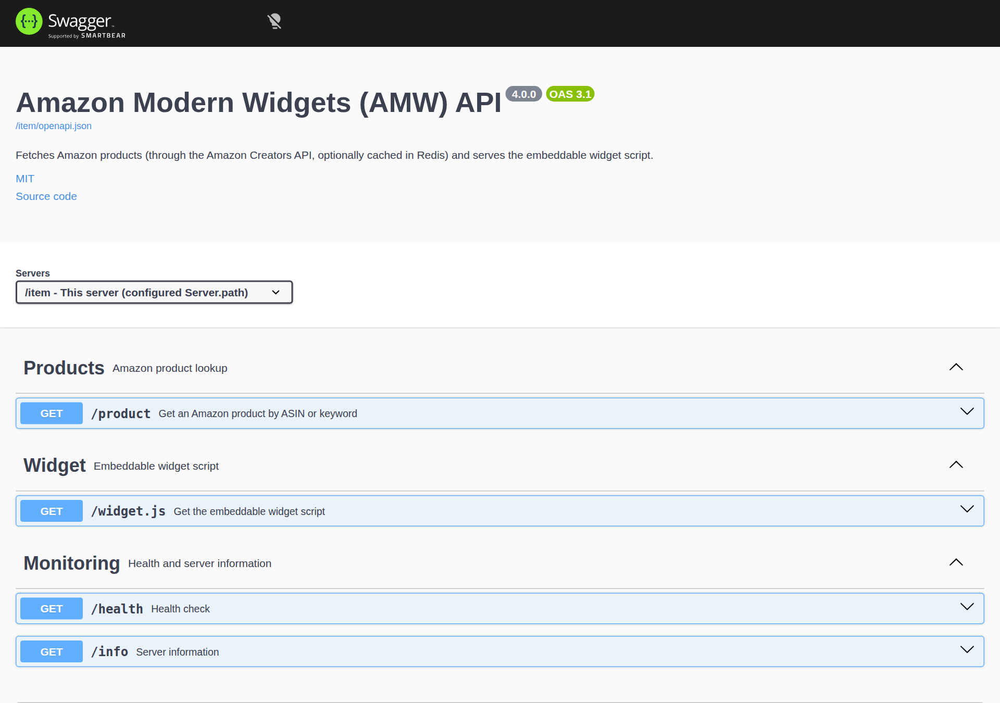

# HTTP API

All endpoints are `GET` and live under the configured base path, written `<path>` below
(`/item` with `config/docker.yml`, `/amw` with `config/sample.yml`). Found products and
the widget script carry `Cache-Control: public, max-age=<Server.httpCache>`, every other
response (errors, 429, `/health`, `/info`) carries `no-store`; the `X-Powered-By` header is
disabled. Compressible responses above 1 KB (the widget script, product JSON, Swagger UI
assets) are compressed with brotli or gzip according to the client's `Accept-Encoding`,
with `Vary: Accept-Encoding`.

| Endpoint | Purpose |
|---|---|
| [`<path>/product`](#get-product) | Product data as JSON (rate limited) |
| [`<path>/widget.js`](#get-widgetjs) | The embeddable widget script |
| [`<path>/health`](#get-health) | Health check |
| [`<path>/info`](#get-info) | Server information |
| [`<path>/openapi.json`](#swagger-ui) | OpenAPI 3 description (only when `Server.swagger` is `true`) |
| [`<path>/docs/`](#swagger-ui) | Interactive Swagger UI (only when `Server.swagger` is `true`) |

## `GET <path>/product` { #get-product }

Returns one product, looked up by ASIN or by keyword.

| Query parameter | Constraints | Description |
|---|---|---|
| `id` | string, max 50 characters | Amazon product identifier (ASIN). Looked up with `GetItems`. |
| `keyword` | string, max 100 characters | Search terms. The first `SearchItems` result is returned. |

At least one of them is required; if both are given, `id` wins. Control characters and
`< > " '` are removed and surrounding whitespace is trimmed before the lookup.

```bash
curl "https://your-site.example/item/product?id=B084DN3XVN"
curl "https://your-site.example/item/product?keyword=arduino"
```

**200 OK**

```json
{
  "image": "https://m.media-amazon.com/images/I/....jpg",
  "title": "Product title",
  "url": "https://www.amazon.fr/dp/B084DN3XVN?tag=yourtag-21&linkCode=...",
  "brand": "Brand",
  "asin": "B084DN3XVN",
  "price": "16,39 €",
  "timestamp": 1765230898000,
  "savings": 0
}
```

| Field | Description |
|---|---|
| `image` | URL of the primary large image. |
| `title` | Product title. |
| `url` | Product page URL including your partner tag. |
| `brand` | Brand, or an empty string. |
| `asin` | ASIN of the returned product. |
| `price` | Price of the first offer as formatted by Amazon, or `-1` when there is no offer. |
| `timestamp` | Time AMW fetched the product from Amazon (milliseconds since epoch). |
| `savings` | Discount percentage of the first offer, `0` when none. |

**Errors**

| Status | `error` | When |
|---|---|---|
| `400` | `Validation Error` | `id` and `keyword` are both missing or empty (also after sanitization, e.g. `?id=%20`), a parameter is repeated (array) or too long. |
| `404` | `Product Not Found` | Amazon reports the item as missing (unknown or unavailable ASIN, no search result) or returns unusable product data. |
| `429` | n/a (body: `Too many requests, please try again later.`) | More than `Server.rateLimit` requests from the same client IP within one minute. |
| `500` | `Internal Server Error` | Unexpected error. |
| `502` | `Bad Gateway` | The Amazon call failed: invalid credentials, Amazon server error, network error, malformed answer. Details are logged server-side. |
| `503` | `Service Unavailable` | Amazon throttled the request (your API quota is exhausted for now). A `Retry-After` header (Amazon's value, 60 s by default) tells clients when to retry. |
| `504` | `Gateway Timeout` | Amazon did not answer in time (Amazon-side timeout, or more than 30 seconds). |

Only successful lookups are cached; errors are never stored in Redis.

JSON error bodies have the form:

```json
{
  "error": "Validation Error",
  "message": "Missing required parameter: id or keyword",
  "timestamp": "2026-10-20T12:00:00.000Z"
}
```

### Rate limiting

`/product` is limited per client IP (as resolved by
[`Server.trustProxy`](../installation/configuration.md#server)) over a fixed one-minute window. Responses
include the IETF draft-8 headers `RateLimit-Policy` and `RateLimit`; a rejected request
gets HTTP 429 with a `Retry-After` header (seconds). The other endpoints are not rate limited.

## `GET <path>/widget.js` { #get-widgetjs }

Serves the minified widget (`<Server.projectDir>/dist/widgets/widget.js`) with
`Content-Type: application/javascript`. See [Add widgets to your website](integration.md).

## `GET <path>/health` { #get-health }

```json
{
  "status": "ok",
  "version": "4.0.0",
  "timestamp": "2026-10-20T12:00:00.000Z",
  "uptime": 3600.5,
  "redis": "connected"
}
```

`redis` is `connected`, `disconnected` or `disabled`. The endpoint always answers 200
while the process is up; the Docker `HEALTHCHECK` uses it.

## `GET <path>/info` { #get-info }

```json
{
  "name": "Amazon Modern Widgets (AMW)",
  "version": "4.0.0",
  "author": "Ludovic Toinel",
  "source": "https://github.com/ltoinel/amw",
  "endpoints": ["/item/product", "/item/widget.js", "/item/health", "/item/info"]
}
```

When the Swagger UI is enabled, `endpoints` also lists `<path>/openapi.json` and
`<path>/docs/`.

## Swagger UI and OpenAPI { #swagger-ui }

Set [`Server.swagger: true`](../installation/configuration.md#server) (or `SERVER_SWAGGER=true`) to
expose:

- `GET <path>/openapi.json`: the OpenAPI 3 description of the endpoints above, built
  at startup with the configured base path, rate limit and HTTP cache values;
- `GET <path>/docs/`: Swagger UI, served from the AMW server itself (no CDN).
  `<path>/docs` redirects to `<path>/docs/` (301).

{ loading=lazy }

The Swagger UI is disabled by default; when disabled, its module is not even loaded.
When enabled, its pages are hardened:

- a `Content-Security-Policy` restricts scripts, styles, images and API calls to the
  AMW origin and forbids framing (`frame-ancestors 'none'`);
- the UI always loads `<path>/openapi.json`: the `?url=` query parameter is ignored, so
  the page cannot be pointed at a third-party document;
- the online validator badge is disabled, so the document is never sent to
  `validator.swagger.io`.

"Try it out" sends real requests: `/product` calls count against your Amazon quota and
the rate limit like any other.

## Other routes

Any other path returns **404** with `{"error": "Not Found", "message": "Route <url> not found", ...}`.
