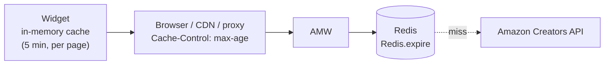

# Caching & quotas

## Amazon API quotas

The Creators API has no price, but Amazon limits the calls of each account. According to its
[rates and limits](https://affiliate-program.amazon.com/creatorsapi/docs/en-us/concepts/api-rates):

| Period | Requests per second | Requests per day |
|---|---|---|
| First 30 days after creating the credentials | 1 | 8,640 |
| Then, from the shipped revenue of the previous 30 days | 1 per 4,320 of revenue, at most 10 | 1 per 0.05 of revenue |

- **Shipped revenue** is the sales volume of the items shipped through your API links, not your
  commissions. For example, 2,000 of shipped revenue gives about 40,000 requests per day.
- The allocation is updated daily. The page writes amounts in dollars and names no currency.
- **Without qualified sales for 30 days in a row, the account loses access to the API**, and
  gets it back within two days after new referred sales ship.
- Past the quota, Amazon answers `429 TooManyRequests` and AMW answers HTTP 503 with a
  `Retry-After` header until Amazon accepts calls again.

The [administration portal](admin-portal.md#amazon-quota) estimates this quota from your revenue.

## Caching layers

AMW is designed so that most page views never reach Amazon:



| Layer | Controlled by | Notes |
|---|---|---|
| Widget memory cache | fixed, 5 minutes | Avoids duplicate requests within a page session. |
| HTTP caches | `Server.httpCache` | Found products and `widget.js` carry `Cache-Control: public, max-age=<httpCache>`; errors, rate-limit answers and `/health` carry `no-store`, so a transient failure is never replayed by a cache. |
| NGINX micro-cache / CDN | your proxy | See [Reverse proxy](../installation/reverse-proxy.md#micro-caching-optional) and [Caching products in Cloudflare](#cloudflare). |
| Redis | `Redis.enabled`, `Redis.expire`, `Redis.staleExpire` | Shared by all visitors; survives AMW restarts. Products are fresh for `Redis.expire` and kept `Redis.staleExpire` longer as a fallback. |
| Not-found cache | `Redis.notFoundExpire` | Remembers products Amazon does not know (in Redis, or in memory without Redis). |

## Amazon price freshness

The Amazon Associates Program requires the price and availability shown to visitors to
be **less than 24 hours old**. AMW enforces it on the server side:

- `Redis.expire` is capped at `86400` seconds (a larger value is lowered at startup,
  with a warning in the logs). The Docker default is 12 hours.
- A cached product older than 24 hours is never served, not even as a fallback while
  Amazon is down: it is fetched again, or the Amazon error is returned.
- The `Cache-Control: max-age` of a product response is
  `min(Server.httpCache, 24 h - age of the product)`, so browsers and CDNs drop it
  before it turns 24 hours old.

Recommended production values: `Redis.expire` between a few hours and 24 hours, and an
`httpCache` of a few hours (it also applies to `widget.js`).

## Caching products in Cloudflare { #cloudflare }

The widget requests each product on its own URL (`/product?id=<ASIN>`), so a CDN can
serve it to every page and every visitor. Views are reported separately by the `/view`
beacon, which is a `POST` and never cached: statistics stay accurate however much is
served by the CDN. Each displayed page still sends AMW about one beacon, while product
requests only reach it on a CDN miss.

Cloudflare does not cache JSON by default. Add a **Cache Rule** matching
`/item/product` (adapt to your `Server.path`):

- **Cache eligibility**: eligible for cache.
- **Edge TTL**: use the cache-control header if present, bypass the cache if not.
- **Browser TTL**: respect origin.

Do not force a TTL, on this rule or in the zone settings: the origin's `max-age` is what
keeps prices under 24 hours, and errors and 404s stay uncached thanks to `no-store`.

Then check it, as `cf-cache-status` should go from `MISS` to `HIT`, with an `Age` header:

```bash
curl -sI "https://www.example.com/item/product?id=B084DN3XVN" | grep -iE "cf-cache-status|cache-control|^age"
```

!!! warning "Count Cloudflare in `Server.trustProxy`"
    Cloudflare is one more proxy hop: with Cloudflare and NGINX, `Server.trustProxy` is
    `2`. With a lower value, AMW takes a Cloudflare address for the client IP and the
    visitors behind it share one rate limit counter, unless your proxy restores the
    real address first (NGINX `real_ip` module). See
    [Reverse proxy](../installation/reverse-proxy.md).

## Protecting the quota

- `Server.rateLimit` caps `/product` calls per client IP and per minute (default 120).
- Requests are validated before any cache or Amazon lookup, so malformed calls cost
  nothing.
- Each lookup requests a minimal set of resources (image, title, brand, price).
- Concurrent requests for the same uncached product share a single Amazon call.
- Products Amazon does not know are remembered for `Redis.notFoundExpire` seconds.

## When Amazon fails

- If Amazon fails (error, timeout, throttling) and the cache still holds an expired copy
  of the product (kept `Redis.staleExpire` seconds after `Redis.expire`) that is less
  than 24 hours old, AMW serves that copy with HTTP 200; its `timestamp` tells how old
  it is.
- After `Amazon.breakerThreshold` consecutive failures the circuit breaker opens: AMW
  stops calling Amazon for `Amazon.breakerCooldown` seconds, serves stale copies when
  it has them and otherwise answers HTTP 503 with a `Retry-After` header. A single trial
  call then decides whether Amazon is back.
