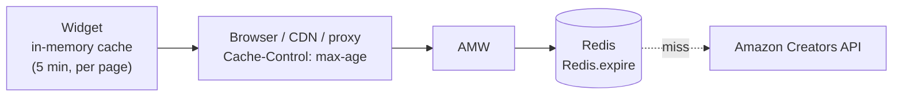

# Caching & quotas

## Amazon API quotas

Amazon throttles its product APIs per Associates account. Historically, new accounts
start around **1 request per second and 8,640 requests per day**, and the quota then
grows with the revenue generated by your shipped items. Check the current rules in the
[Creators API documentation](https://affiliate-program.amazon.com/creatorsapi): when
the quota is exceeded, Amazon rejects calls and AMW answers HTTP 503 with a
`Retry-After` header until Amazon accepts calls again.

## Caching layers

AMW is designed so that most page views never reach Amazon:

| Layer | Controlled by | Notes |
|---|---|---|
| Widget memory cache | fixed, 5 minutes | Avoids duplicate requests within a page session. |
| HTTP caches | `Server.httpCache` | Found products and `widget.js` carry `Cache-Control: public, max-age=<httpCache>`; errors, rate-limit answers and `/health` carry `no-store`, so a transient failure is never replayed by a cache. |
| NGINX micro-cache / CDN | your proxy | See [Reverse proxy](../installation/reverse-proxy.md#micro-caching-optional). |
| Redis | `Redis.enabled`, `Redis.expire`, `Redis.staleExpire` | Shared by all visitors; survives AMW restarts. Products are fresh for `Redis.expire` and kept `Redis.staleExpire` longer as a fallback. |
| Not-found cache | `Redis.notFoundExpire` | Remembers products Amazon does not know (in Redis, or in memory without Redis). |

Recommended production values: a long `Redis.expire` (the Docker default is about one
month) and an `httpCache` of a few hours to a week. Prices shown by the widget are then
as old as the cache: the card displays the last update date so visitors know it.

## Protecting the quota

- `Server.rateLimit` caps `/product` calls per client IP and per minute (default 120).
- Requests are validated before any cache or Amazon lookup, so malformed calls cost
  nothing.
- Each lookup requests a single item and a minimal set of resources (image, title,
  brand, price).
- Concurrent requests for the same uncached product share a single Amazon call.
- Products Amazon does not know are remembered for `Redis.notFoundExpire` seconds.

## When Amazon fails

- If Amazon fails (error, timeout, throttling) and the cache still holds an expired copy
  of the product (kept `Redis.staleExpire` seconds after `Redis.expire`), AMW serves
  that copy with HTTP 200; its `timestamp` tells how old it is.
- After `Amazon.breakerThreshold` consecutive failures the circuit breaker opens: AMW
  stops calling Amazon for `Amazon.breakerCooldown` seconds, serves stale copies when
  it has them and otherwise answers HTTP 503 with a `Retry-After` header. A single trial
  call then decides whether Amazon is back.
