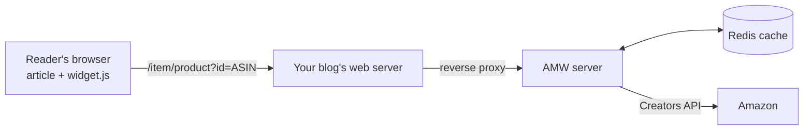

# What is AMW?

**Amazon Modern Widgets (AMW)** displays Amazon products on your website as modern,
responsive cards that carry your Amazon Associates partner tag. It replaces the dated
widgets offered by Amazon with cards that load fast, look good on any theme and stay
friendly to search engines.

{ width="560" loading=lazy }

## How it works

1. You write `

` where a product should appear.
2. The `widget.js` script, served by your AMW server, finds these placeholders.
3. For each one, it asks AMW for the product (title, image, price, savings, link with
   your partner tag). AMW answers from its cache or queries the Amazon Creators API.
4. The widget renders the card; a click opens the product on Amazon.

## Features at a glance

-   :material-card-text-outline:{ .lg .middle } **Product cards**

    ---

    Image, title, price, `-NN%` savings badge, localized call to action; the whole card
    links to Amazon with your partner tag.

    [:octicons-arrow-right-24: Product cards](widget.md)

-   :material-lightning-bolt:{ .lg .middle } **Lazy loading**

    ---

    Cards are filled only when they scroll into view, with a placeholder meanwhile.

    [:octicons-arrow-right-24: Lazy loading](widget.md#lazy-loading)

-   :material-translate:{ .lg .middle } **Seven languages**

    ---

    French, English, Spanish, German, Italian, Portuguese and Dutch, from `<html lang>`.

    [:octicons-arrow-right-24: Languages](widget.md#languages)

-   :material-google:{ .lg .middle } **SEO friendly**

    ---

    schema.org `Product` JSON-LD for each product, `sponsored nofollow` links.

    [:octicons-arrow-right-24: Structured data](widget.md#seo-structured-data)

-   :material-database-clock:{ .lg .middle } **Caching**

    ---

    Redis, HTTP and in-browser caches keep pages fast and Amazon API calls low.

    [:octicons-arrow-right-24: Caching & quotas](caching.md)

-   :material-api:{ .lg .middle } **HTTP API & Swagger UI**

    ---

    JSON product lookup by ASIN or keyword, health check, optional interactive docs.

    [:octicons-arrow-right-24: HTTP API](api.md)

-   :material-speedometer:{ .lg .middle } **Rate limiting**

    ---

    Per-visitor limit on product requests protects your Amazon quota.

    [:octicons-arrow-right-24: Rate limiting](api.md#rate-limiting)

-   :material-shield-check:{ .lg .middle } **Secure by default**

    ---

    Untrusted data never reaches the page as HTML, strict input validation, hardened
    Docker image.

    [:octicons-arrow-right-24: Security](security.md)

## Works everywhere

AMW works with any website or CMS that lets you insert HTML: Ghost, WordPress, Drupal,
Joomla, Dotclear, static site generators, and so on. You need a server (or container)
to run AMW and a web server able to proxy one path to it; see the
[installation tutorial](../installation/index.md).

## Administration portal

A web administration portal shows usage statistics (hits, clicks, most displayed
products, best performing pages, products to replace): see
[Administration portal](admin-portal.md).
