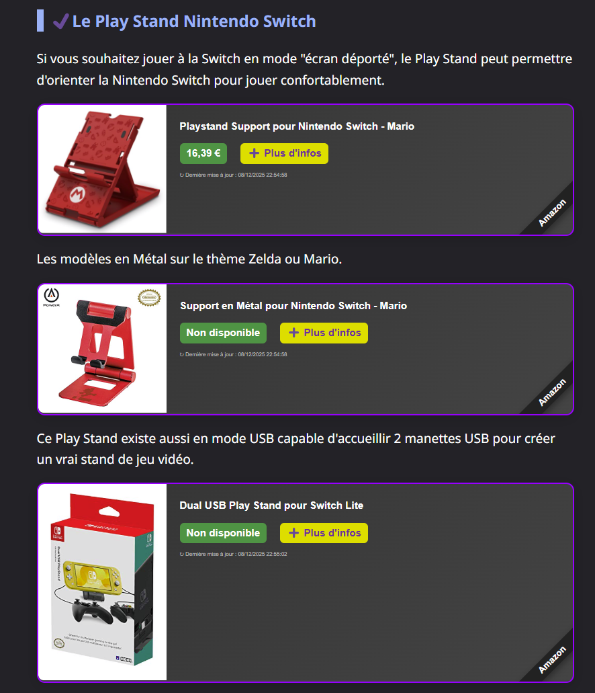

# Product cards

Each `
` placed in a page becomes a product card. This page
shows what visitors see; [Add widgets to your website](integration.md) explains how to
embed them.

{ loading=lazy }

## Anatomy of a card

{ loading=lazy }

| Element | Content |
|---|---|
| Image | The product's main image, from Amazon's CDN. |
| Title | The product title, truncated to 70 characters. |
| Price | The price of the first offer, as formatted by Amazon for your marketplace. |
| Savings badge | `-NN%`, shown only when the offer has a discount. |
| Call to action | A localized button label (see [Languages](#languages)). |
| Last update | When AMW fetched the product from Amazon, formatted with the visitor's locale. A long [cache](caching.md) means an older date. |
| `#Amazon` ribbon | Corner ribbon telling visitors the link leads to Amazon. |

The **whole card is a link** to the product page on Amazon, carrying your partner tag,
opened in a new tab with `rel="sponsored nofollow"` as search engines expect for
affiliate links.

## Product without offer

When Amazon returns no offer (out of stock, marketplace-only listing, ...), the price is
replaced by a localized "not available" label; the card still links to the product.

{ loading=lazy }

## Lazy loading

Cards are filled **only when they are about to become visible** (50 px before they
enter the viewport, using `IntersectionObserver`). Until then the card shows a light
placeholder, so a long article with many products loads as fast as one without.

{ loading=lazy }

Browsers without `IntersectionObserver` load every card immediately. Cards added to the
page later (single-page applications, infinite scroll) are detected automatically.

## Errors

When the product cannot be loaded (unknown ASIN, network error or timeout after 10 s),
the widget retries once after 1 s, then shows a localized error message instead of an
empty box. Because the server answers HTTP 404 for an unknown product, that case is
currently reported with the same "connection error" message:

{ loading=lazy }

## Languages

The language is read from the page's `<html lang="...">` attribute and must be one of
the exact values below. Any other value, including regional variants such as `en-US`,
and a missing attribute fall back to **French**.

| `lang` | Language | Button label |
|---|---|---|
| `fr` | French (default) | ➕ Plus d'infos |
| `en` | English | 🚀 Let's go ! |
| `es` | Spanish | 🚀 Yo voy ! |
| `de` | German | 🚀 Los geht's! |
| `it` | Italian | 🚀 Andiamo! |
| `pt` | Portuguese | 🚀 Vamos lá! |
| `nl` | Dutch | 🚀 Laten we gaan! |

The same card on a page with `<html lang="fr">`:

{ loading=lazy }

## SEO: structured data

For each rendered product, the widget appends a schema.org `Product` JSON-LD block to
`<head>` (name, image, brand, SKU/ASIN, offer price, currency and availability), which
search engines can use for rich results. Card links are marked `sponsored nofollow`.

## Performance in the browser

| Behaviour | Value |
|---|---|
| Lazy loading | starts 50 px before the card enters the viewport |
| Request timeout | 10 s |
| Retries | 1 retry after 1 s on timeout or error |
| In-memory cache | 5 minutes per product and language, per page |
| Stylesheet | injected once per page |

## In production

AMW cards in a real blog post (French page, dark theme):

{ width="600" loading=lazy }
