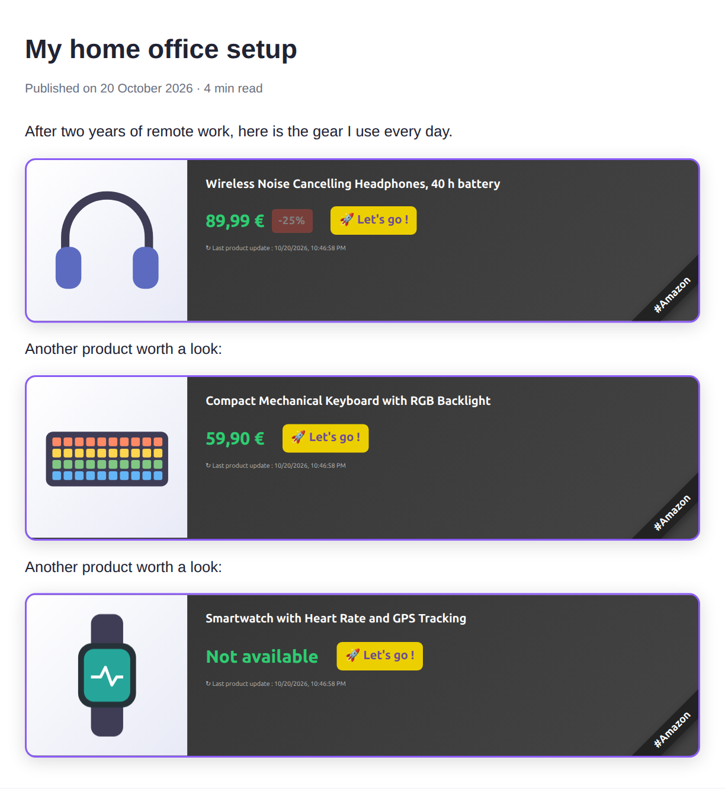
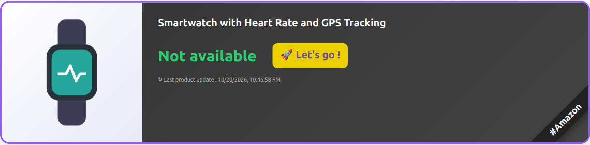
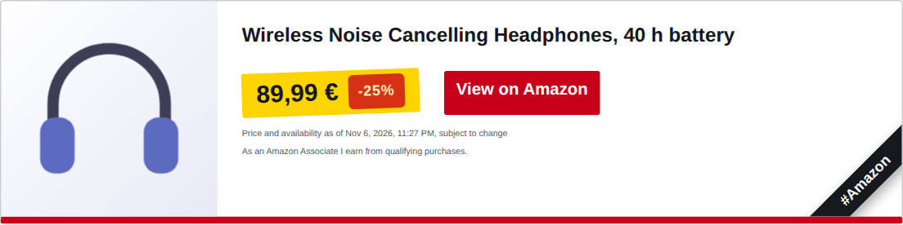
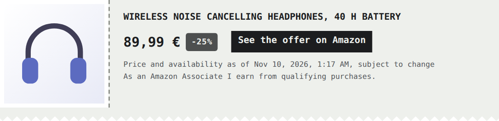
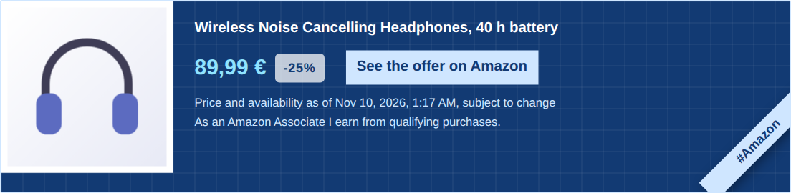
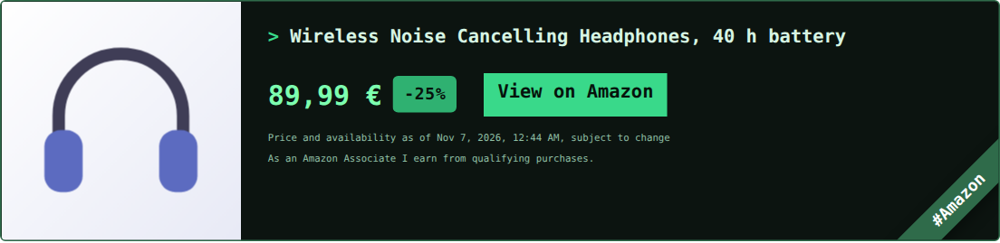
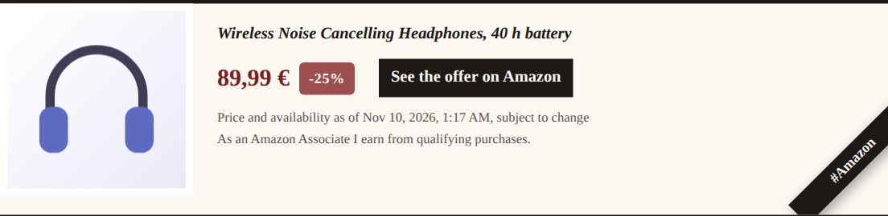
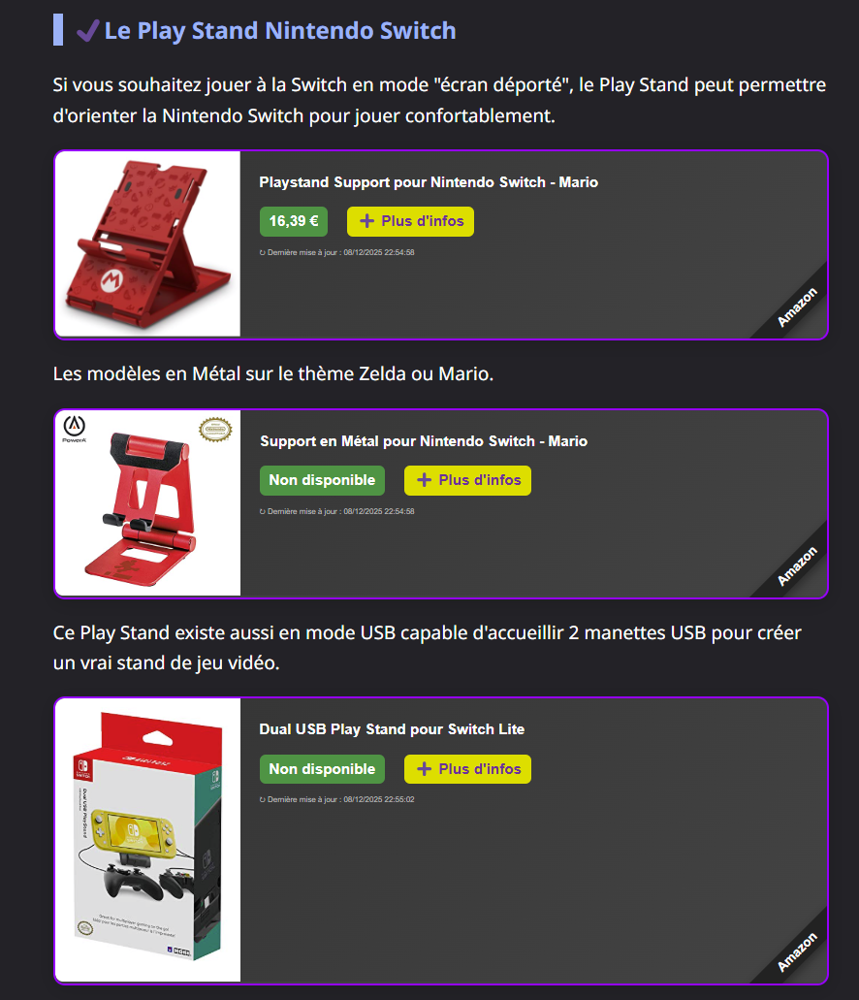

# Product cards

Each `<div class="amw" id="ASIN">` placed in a page becomes a product card. This page
shows what visitors see; [Add widgets to your website](integration.md) explains how to
embed them.

{ loading=lazy }

## Anatomy of a card

{ loading=lazy }

| Element | Content |
|---|---|
| Image | The product's main image, from Amazon's CDN. |
| Title | The product title, truncated to 70 characters. |
| Price | The price of the first offer, as formatted by Amazon for your marketplace. |
| Savings badge | `-NN%`, shown only when the offer has a discount. |
| Call to action | A localized button label (see [Languages](#languages)). |
| Last update | When AMW fetched the product from Amazon, formatted with the visitor's locale. A long [cache](caching.md) means an older date. |
| `#Amazon` ribbon | Corner ribbon telling visitors the link leads to Amazon. |

The **whole card is a link** to the product page on Amazon, carrying your partner tag,
opened in a new tab with `rel="sponsored nofollow"` as search engines expect for
affiliate links.

## Product without offer

When Amazon returns no offer (out of stock, marketplace-only listing, ...), the price is
replaced by a localized "not available" label; the card still links to the product.

{ loading=lazy }

## Lazy loading

Cards are filled **only when they are about to become visible** (50 px before they
enter the viewport, using `IntersectionObserver`). Until then the card shows a light
placeholder, so a long article with many products loads as fast as one without.

{ loading=lazy }

Browsers without `IntersectionObserver` load every card immediately. Cards added to the
page later (single-page applications, infinite scroll) are detected automatically.

## Errors

When Amazon does not know the product (wrong ASIN, product withdrawn from the
catalogue: HTTP 404), the widget **renders nothing**: the `<div>` is hidden, so readers
see neither a card nor an error. It is not retried. You find these products, with the
pages that embed them, among the
[products to replace](admin-portal.md#views-clicks-and-pages) of the administration
portal, and the browser console logs `AMW: Amazon does not know product <ASIN>`.

When the product cannot be loaded (Amazon or network error, timeout after 10 s), the
widget retries once after 1 s, then shows a localized error message:

{ loading=lazy }

## Automatic product { #auto }

Without an `id`, the card shows the product a reader of the page is most likely to buy, with
no ASIN to choose:

```html
<div class="amw"></div>
```

The first time a page is requested, AMW downloads it to read its title (`og:title`, then
`<title>`), its site (`og:site_name`) and its description (`og:description`, then
`description`), and Claude picks the Amazon search terms. They are kept in Redis without expiry,
so later visits make no Claude call. The widget only sends the MD5 of the page URL, without
query string: pages differing only by their query string share one product.

If no product suits the page (a legal notice, for example), or if Amazon finds none, the card
shows the most clicked product of the same site over the last 30 days. With no clicks yet, it
hides itself. A chosen product changes only if the Amazon search result changes.

This needs [`Recommendation.enabled`](../installation/configuration.md#recommendation),
which is off by default, as well as Redis and a Claude API key. Only these public details of
the page are sent to Anthropic, never anything about the visitor.

!!! note "Behaviour change"
    A `.amw` element without an `id` used to be ignored with a console warning. It now asks
    for a recommendation, and hides itself while the feature is off.

## Appearance effects { #effects }

A card can appear with a short movement when the visitor reaches it. Choose the effect in the
**A/B tests** view of the [administration portal](admin-portal.md#effects), or with `Effect.mode`
in the [configuration](../installation/configuration.md).

| `Effect.mode` | What happens |
|---|---|
| `none` | No effect, the default |
| `fade` | The card fades in |
| `slide` | The card slides up as it fades in |
| `zoom` | The card grows slightly as it fades in |
| `pulse` | The button pulses twice |
| `compare` | Each tab session gets one of the effects selected in the portal (all by default) at random, to [measure them](admin-portal.md#effects) |

Visitors who ask their system to reduce motion see no effect. An effect is not known to earn more
clicks, and a movement can also feel like an advertisement: measure before keeping one.

## Themes { #themes }

=== "default"

    { loading=lazy }

    Dark gradient with a violet border.

=== "native"

    { loading=lazy }

    Takes the font and the colors of your page, here on a light page.

    On a dark page:

    { loading=lazy }

=== "shelf"

    { loading=lazy }

    White board, red rail, price on a yellow tag.

=== "receipt"

    { loading=lazy }

    Till receipt with a tear-off edge.

=== "blueprint"

    { loading=lazy }

    Blue sheet with a drafting grid.

=== "outdoor"

    { loading=lazy }

    Pine green patch with a stitched line.

=== "terminal"

    { loading=lazy }

    Green phosphor on a black screen, with a prompt before the title.

=== "magazine"

    { loading=lazy }

    Cream paper, serif type and printed rules.

=== "pastel"

    { loading=lazy }

    Pale gradient, very round corners and a pill-shaped button.

=== "neon"

    { loading=lazy }

    Deep purple night, a pink tube around the card and a cyan price. The glow does not move.

Only `native` follows the colors of the page; the other themes look the same on any page.

| Theme | Design | Good for |
|---|---|---|
| `default` | Dark gradient, violet border | Any site, as an eye-catching card |
| `native` | Your page's font and colors, thin frame | Blending into an article, in light or dark mode |
| `shelf` | White board, red rail, price on a yellow tag | Deals and shopping guides |
| `receipt` | Till receipt with a tear-off edge | Personal blogs, wish lists |
| `blueprint` | Blue sheet with a drafting grid | Tech and DIY sites |
| `outdoor` | Pine green patch with a stitched line | Travel and outdoor sites |
| `terminal` | Green phosphor on a black screen | Development and sysadmin blogs |
| `magazine` | Cream paper, serif type, printed rules | Long reads and editorial sites |
| `pastel` | Pale gradient, round corners | Lifestyle, family and craft sites |
| `neon` | Pink glow on a purple night | Gaming and entertainment sites |

Set the default of the server with [`Server.theme`](../installation/configuration.md#server)
(`SERVER_THEME`). An invalid name stops the server at startup, and browsers and CDNs
pick up a change once their copy of `widget.js` expires (one hour).

A site can choose its own, which takes precedence (this is how sites sharing one server
get different designs):

```html
<script src="/item/widget.js" data-theme="native" defer></script>
```

From JavaScript, `AmwWidget.setApiConfig({ theme: 'shelf' })` applies to the widgets
rendered afterwards. An unknown name is ignored with a warning in the console.

Integrations using a hashed `widget.<hash>.js` do not receive `Server.theme`, as that
file never changes: they use `data-theme`.

A [theme A/B test](admin-portal.md#effects), set in the portal, replaces both `Server.theme` and
`data-theme` while it runs: each tab session gets one of the selected themes.

Each alternative theme is its own stylesheet (`themes/<theme>.css`), loaded with `widget.css`
only when it is active: a page does not download the designs it does not use. A theme file that
loads slowly can leave a card in the default look for a moment.

### Adjusting a theme

The colors and shapes are CSS variables named `--amw-*`, listed at the top of
[`widget.css`](https://github.com/ltoinel/amw/blob/develop/src/widgets/widget.css). Your
page can override them, for example to use your brand color. A theme's own values have
a higher specificity, so match its selector:

```css
.amw-widget[data-amw-theme="shelf"] { --amw-buy-bg: #004b87; }
```

## Languages

The widget uses the first language it supports among, in order:

1. the `data-lang` attribute of the widget's `<div>` (to show one card in another language);
2. the page's `<html lang="...">` attribute;
3. the visitor's browser languages (`navigator.languages`);
4. English.

Language tags are matched case-insensitively on their primary subtag, so `en-US`,
`en-GB` and `EN` all select English, and `pt-BR` selects Portuguese. The full tag keeps
its region for the update date, formatted with `Intl.DateTimeFormat` in that language
(`en-GB` writes 23 Oct 2026, `en-US` Oct 23, 2026), whatever the browser's own locale.

| Language | Tags | Button label |
|---|---|---|
| English (fallback) | `en`, `en-*` | View on Amazon |
| French | `fr`, `fr-*` | Voir sur Amazon |
| Spanish | `es`, `es-*` | Ver en Amazon |
| German | `de`, `de-*` | Bei Amazon ansehen |
| Italian | `it`, `it-*` | Vedi su Amazon |
| Portuguese | `pt`, `pt-*` | Ver na Amazon |
| Dutch | `nl`, `nl-*` | Bekijk op Amazon |

The affiliate disclosure of each language is the wording of the Amazon Associates
program of that country.

### Adding a language or changing a label

`AmwWidget.setTranslations(language, labels)` adds a language, or overrides some labels
of an existing one, for the widgets rendered afterwards. Labels a new language leaves
out come from English; they are inserted as text, never as HTML.

```html
<!-- In <head>, without defer or async: widgets are rendered at DOMContentLoaded, after -->
<script src="https://your-blog.example/item/widget.js"></script>
<script>
  AmwWidget.setTranslations('pl', {
    buy: 'Zobacz w Amazon',
    disclosure: 'Jako Partner Amazon zarabiam na kwalifikujących się zakupach.'
  });
  AmwWidget.setTranslations('fr', { buy: 'Acheter' });
</script>
```

When `widget.js` is loaded with `defer` or `async`, it renders the widgets as soon as it
runs, before a later script can call `setTranslations()`: only the cards not yet in view
(lazy loading, the default) and the widgets added afterwards then use the new labels.

Available labels: `buy`, `default_title` (title of a product without one),
`price_disclaimer` (with a `{date}` placeholder), `disclosure`, `not_available`,
`loading`, `error_network`, `error_timeout`, `error_retry_message`,
`savings`, `sponsored`, `new_tab`.

The same card on a page with `<html lang="fr">`:

{ loading=lazy }

## SEO: structured data

For each rendered product, the widget appends a schema.org `Product` JSON-LD block to
`<head>` (name, image, brand, SKU/ASIN, offer price, currency and availability), which
search engines can use for rich results. Only crawlers read it, so it is injected when
the browser is idle (`requestIdleCallback`, at most 2 s later) and never delays the
card. Card links are marked `sponsored nofollow`.

## Performance in the browser

| Behaviour | Value |
|---|---|
| Lazy loading | starts 50 px before the card enters the viewport |
| Product requests | one cacheable [`/product`](api.md#get-product) request per product, 5 at a time; widgets showing the same product share it |
| View beacon | the cards displayed within one second share one [`/view`](api.md#post-view) beacon, also sent when the page is left; a product is reported once per page and tab session |
| Request timeout | 10 s |
| Retries | 1 retry after 1 s on timeout or error |
| In-memory cache | 5 minutes per product and language, per page |
| Stylesheet | injected once per page |
| Script size | about 17 KB minified, compressed with brotli or gzip by the server |

## In production

AMW cards in a real blog post (French page, dark theme):

{ width="600" loading=lazy }
